# 按年代浏览作品

[图集首页](../gallery.md) · [完整数据](../catalog.json) · [分类标准](../TAXONOMY.md)

## 1860s · 13 件

| 作品 | 作品 | 作品 |
|:---|:---|:---|
| [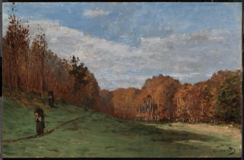](https://commons.wikimedia.org/wiki/File:Monet_-_Woodgatherers_at_the_Edge_of_the_Forest,_about_1863.jpg) **Woodgatherers at the Edge of the Forest, about 1863** · 1863 Museum of Fine Arts, Boston · Public domain | [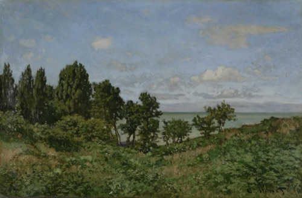](https://commons.wikimedia.org/wiki/File:Claude_Monnet.Coastal_landscape.jpg) **Coastal landscape** · 1864date QS:P571,+1864-00-00T00:00:00Z/9 Van Gogh Museum · Public domain | [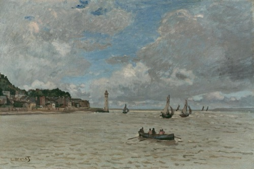](https://commons.wikimedia.org/wiki/File:Claude_Monet_-_Le_Phare_de_Honfleur_-_1968-0004_-_Kunsthaus_Z%C3%BCrich.jpg) **Lighthouse at Honfleur** · 1864 Kunsthaus Zürich · Public domain |
| [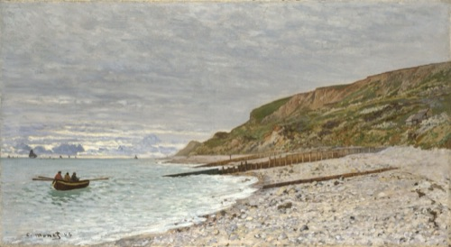](https://commons.wikimedia.org/wiki/File:Monet_Pointe_de_la_H%C3%A8ve.jpg) **Pointe de la Hève** · 1864date QS:P571,+1864-00-00T00:00:00Z/9 The National Gallery, London · Public domain | [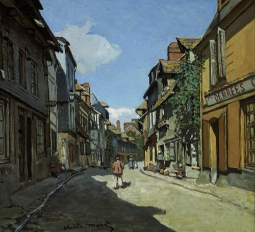](https://commons.wikimedia.org/wiki/File:Claude_Monet_-_Rue_de_la_Bavole,_Honfleur_-_Google_Art_Project.jpg) **Rue de la Bavole, Honfleur** · about 1864 Museum of Fine Arts, Boston · Public domain | [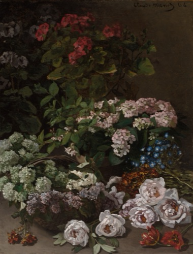](https://clevelandart.org/art/1953.155) **Spring Flowers** · 1864 Cleveland Museum of Art · CC0 |
| [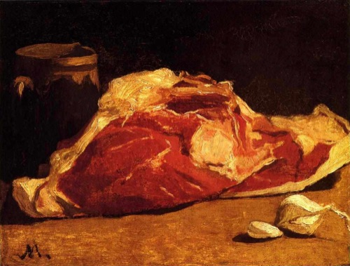](https://commons.wikimedia.org/wiki/File:Monet_-_Stilleben_mit_Fleisch.jpg) **Stilleben mit Fleisch** · 1864 Musée d'Orsay · Public domain | [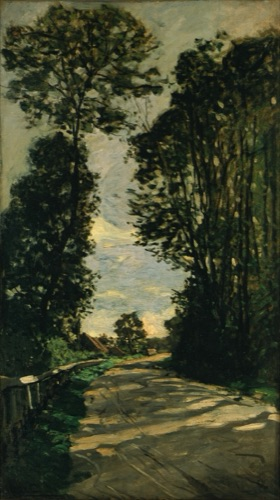](https://commons.wikimedia.org/wiki/File:Claude_Monet_-_Walk_(Road_of_the_Farm_Saint-Sim%C3%A9on)_-_Google_Art_Project.jpg) **Walk (Road of the Farm Saint-Siméon)** · 1864date QS:P571,+1864-00-00T00:00:00Z/9 National Museum of Western Art, Tokyo · Public domain | [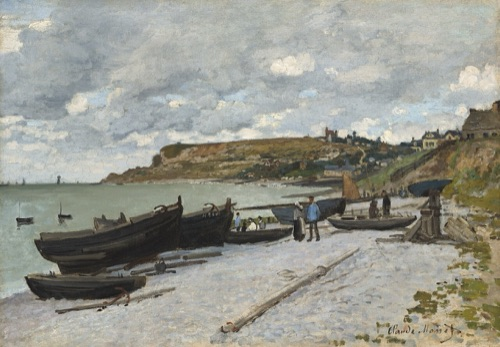](https://commons.wikimedia.org/wiki/File:Claude_Monet,_Sainte-Adresse,_1867,_NGA_71550.jpg) **Sainte-Adresse** · 1867 National Gallery of Art · CC0 |
| [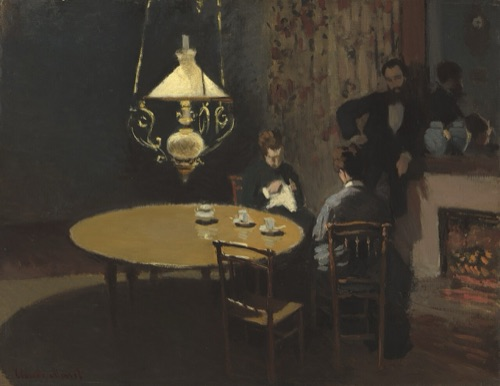](https://commons.wikimedia.org/wiki/File:Claude_Monet,_Interior,_after_Dinner,_1868-1869,_NGA_61376.jpg) **Interior, after Dinner** · 1868-1869 National Gallery of Art · CC0 | [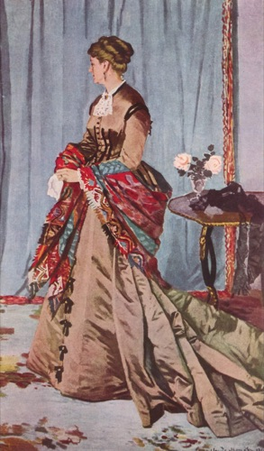](https://commons.wikimedia.org/wiki/File:Claude_Monet_036.jpg) **Madame Louis Joachim Gaudibert** · 1868date QS:P571,+1868-00-00T00:00:00Z/9 Musée d'Orsay · Public domain | [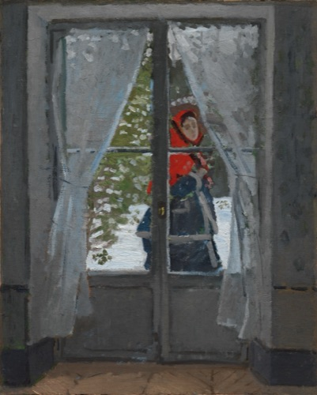](https://clevelandart.org/art/1958.39) **The Red Kerchief** · c. 1868–73 Cleveland Museum of Art · CC0 |
| [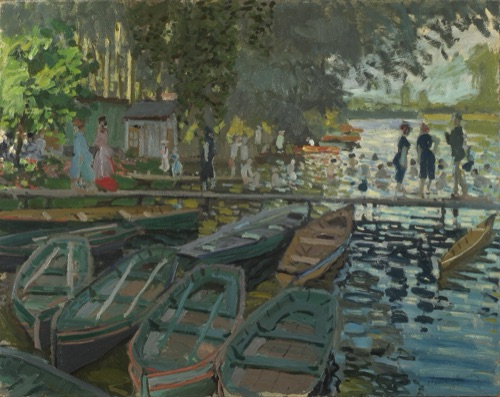](https://commons.wikimedia.org/wiki/File:Monet_-_Bathers_at_La_Grenouill%C3%A8re.jpg) **Bathers at La Grenouillère** · 1869 The National Gallery, London · Public domain | — | — |

## 1870s · 41 件

| 作品 | 作品 | 作品 |
|:---|:---|:---|
| [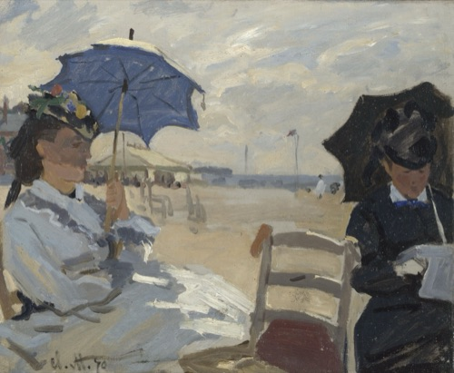](https://commons.wikimedia.org/wiki/File:Claude_Monet_002.jpg) **La plage de Trouville** · 1870date QS:P571,+1870-00-00T00:00:00Z/9 The National Gallery, London · Public domain | [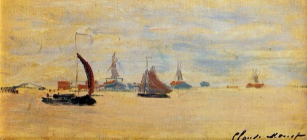](https://commons.wikimedia.org/wiki/File:Monet_1871_View_of_the_Voorzaan.jpg) **1871 View of the Voorzaan** · 1871 Musée Marmottan Monet · Public domain | [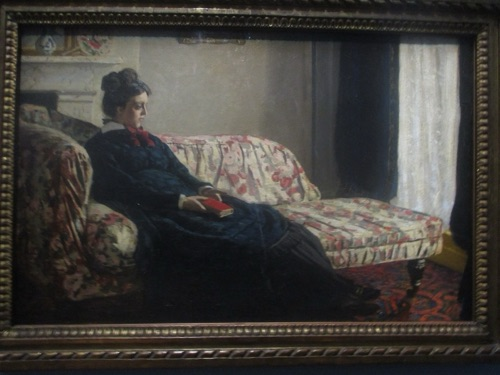](https://commons.wikimedia.org/wiki/File:Madame_Monet_1871.jpg) **Madame Monet 1871** · 1871 Musée d'Orsay · Public domain |
| [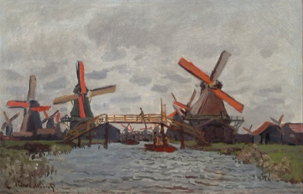](https://commons.wikimedia.org/wiki/File:Claude_Monet_-_Mills_at_Westzijderveld_near_Zaandam_-_Google_Art_Project.jpg) **Mills at Westzijderveld near Zaandam** · 1871date QS:P571,+1871-00-00T00:00:00Z/9 Van Gogh Museum · Public domain | [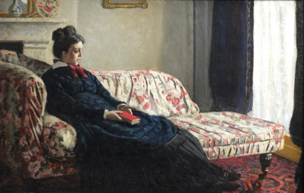](https://commons.wikimedia.org/wiki/File:Madame_Monet_au_canap%C3%A9_Monet_1871.jpg) **Méditation, madame Monet au canapé** · circa 1871date QS:P571,+1871-00-00T00:00:00Z/9,P1480,Q5727902 Prise de Musée d'Orsay · Public domain | [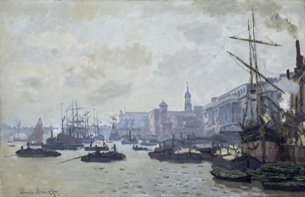](https://commons.wikimedia.org/wiki/File:Amgueddfa_Cymru_-_Afon_Tafwys_yn_Llundain_-_The_Pool_of_London_-_2651.jpeg) **The Pool of London** · 1871date QS:P571,+1871-00-00T00:00:00Z/9 Amgueddfa Cymru – Museum Wales · CC0 |
| [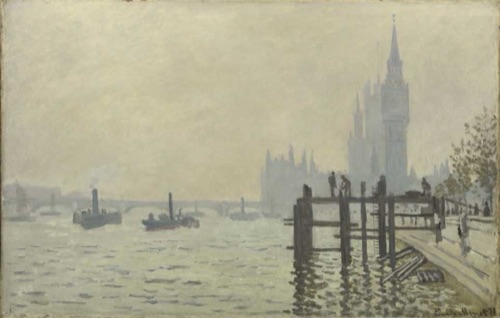](https://commons.wikimedia.org/wiki/File:The_Thames_below_Westminster_1522133421-1774a.jpg) **The Thames below Westminster** · 1871date QS:P571,+1871-00-00T00:00:00Z/9 The National Gallery, London · Public domain | [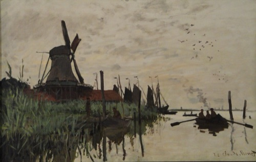](https://commons.wikimedia.org/wiki/File:Windmill_and_Boats_near_Zaandam,_Holland,_by_Claude_Monet,_1871_-_Ny_Carlsberg_Glyptotek_-_Copenhagen_-_DSC09437.JPG) **Windmill and Boats near Zaandam, Holland** · 1871 ; 2012-05-12 09:29:05 Ny Carlsberg Glyptotek · Public domain | [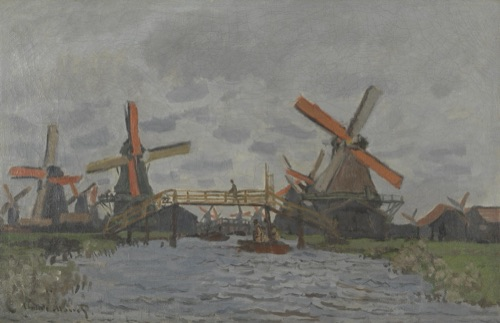](https://commons.wikimedia.org/wiki/File:Molens_bij_Zaandam_-_s0503S2001_-_Van_Gogh_Museum.jpg) **Windmills near Zaandam** · 1871date QS:P571,+1871-00-00T00:00:00Z/9 Van Gogh Museum · Public domain |
| [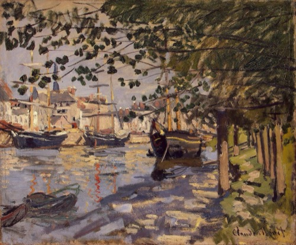](https://commons.wikimedia.org/wiki/File:%27The_Seine_at_Rouen%27_by_Claude_Monet,_1872,_Hermitage.JPG) **'The Seine at Rouen' by Claude Monet, 1872, Hermitage** · 1872date QS:P571,+1872-00-00T00:00:00Z/9 State Hermitage Museum · Public domain | [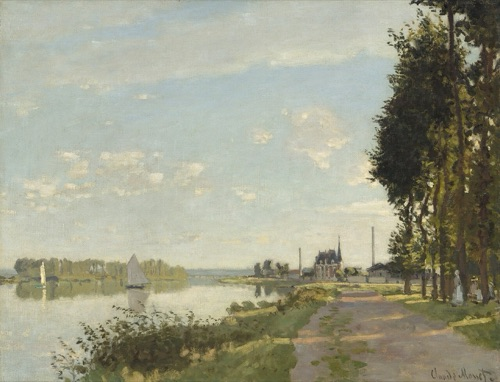](https://commons.wikimedia.org/wiki/File:Claude_Monet,_Argenteuil,_c._1872,_NGA_52186.jpg) **Argenteuil** · c. 1872 National Gallery of Art · CC0 | [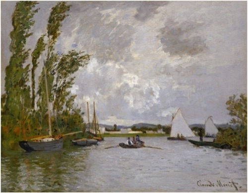](https://commons.wikimedia.org/wiki/File:Argenteuil_Seen_from_the_Small_Branch_of_the_Seine_(1872)_by_Claude_Monet_-_Pola_Museum_of_Art_(Hakone,_Japan).jpg) **Argenteuil Seen from the Small Branch of the Seine (1872) by Claude Monet** · 1872 Pola Museum of Art · Public domain |
| [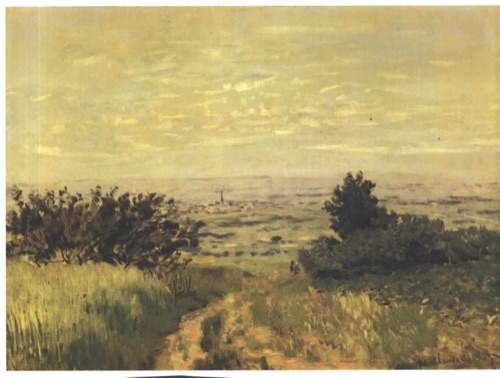](https://commons.wikimedia.org/wiki/File:Monet_-_Blick_auf_die_Ebene_von_Argenteuil.jpg) **Blick auf die Ebene von Argenteuil** · 1872date QS:P571,+1872-00-00T00:00:00Z/9 Musée d'Orsay · Public domain | [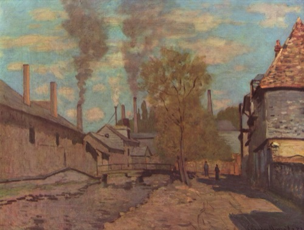](https://commons.wikimedia.org/wiki/File:Claude_Monet_017.jpg) **Der Bach von Robec** · 1872date QS:P571,+1872-00-00T00:00:00Z/9 Musée d'Orsay · Public domain | [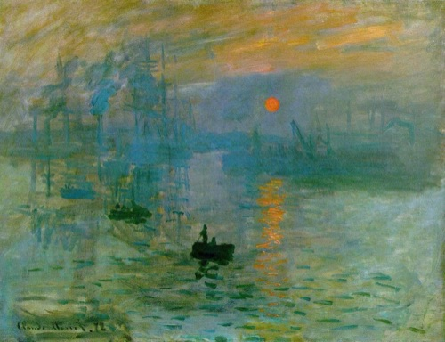](https://commons.wikimedia.org/wiki/File:Claude_Monet,_Impression,_soleil_levant,_1872.jpg) **Impression, soleil levant, 1872** · 1872 Musée Marmottan Monet · Public domain |
| [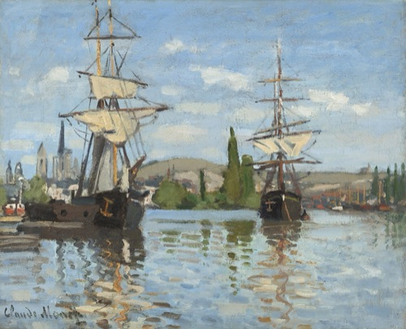](https://commons.wikimedia.org/wiki/File:Claude_Monet,_Ships_Riding_on_the_Seine_at_Rouen,_1872-1873,_NGA_52187.jpg) **Ships Riding on the Seine at Rouen** · 1872-1873 National Gallery of Art · Public domain | [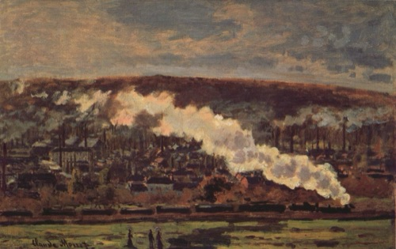](https://commons.wikimedia.org/wiki/File:Claude_Monet_-_The_Train.jpg) **The Goods Train** · 1872date QS:P571,+1872-00-00T00:00:00Z/9 Pola Museum of Art · Public domain | [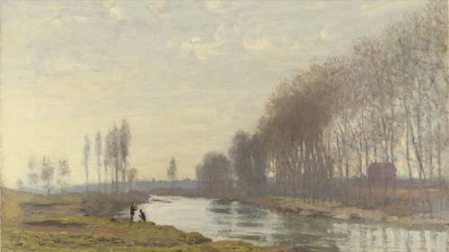](https://commons.wikimedia.org/wiki/File:The_Petit_Bras_of_the_Seine_at_Argenteuil.jpg) **The Petit Bras of the Seine at Argenteuil** · 1872date QS:P571,+1872-00-00T00:00:00Z/9 The National Gallery, London · Public domain |
| [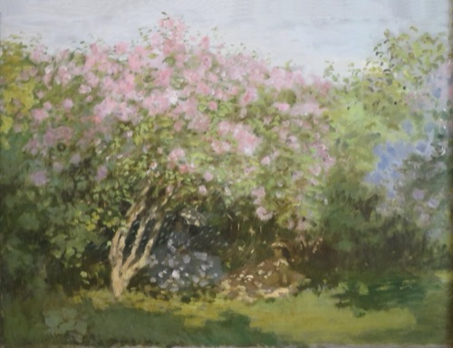](https://commons.wikimedia.org/wiki/File:Lilacs_in_the_Sun,_1872.jpg) **Lilacs in the Sun, 1872** · 1873date QS:P571,+1873-00-00T00:00:00Z/9 Pushkin State Museum of Fine Arts · Public domain | [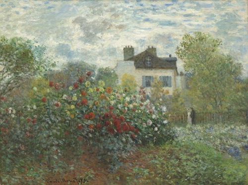](https://commons.wikimedia.org/wiki/File:Claude_Monet,_The_Artist%27s_Garden_in_Argenteuil_(A_Corner_of_the_Garden_with_Dahlias),_1873,_NGA_72138.jpg) **The Artist's Garden in Argenteuil (A Corner of the Garden with Dahlias** · 1873 National Gallery of Art · CC0 | [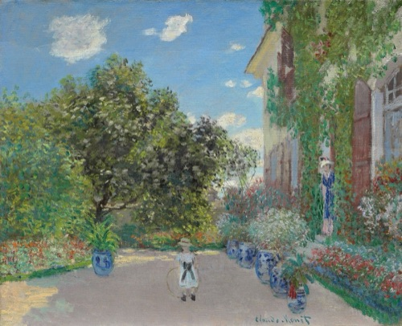](https://commons.wikimedia.org/wiki/File:Claude_Monet_-_The_Artist%27s_House_at_Argenteuil_-_1933.1153_-_Art_Institute_of_Chicago.jpg) **The Artist's House at Argenteuil** · 1873 Art Institute of Chicago · Public domain |
| [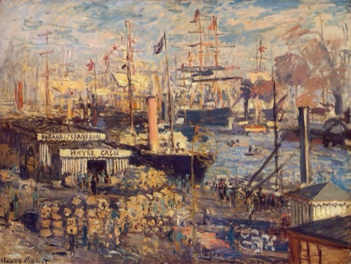](https://commons.wikimedia.org/wiki/File:%27The_Grand_Quay_at_Havre%27_by_Claude_Monet,_1874,_Hermitage.JPG) **'The Grand Quay at Havre' by Claude Monet, 1874, Hermitage** · 1874date QS:P571,+1874-00-00T00:00:00Z/9 State Hermitage Museum · Public domain | [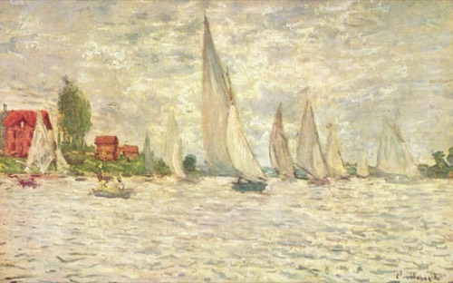](https://commons.wikimedia.org/wiki/File:Claude_Monet_047.jpg) **Segelboote, Regatta in Argenteuil** · circa 1874date QS:P571,+1874-00-00T00:00:00Z/9,P1480,Q5727902 Musée d'Orsay · Public domain | [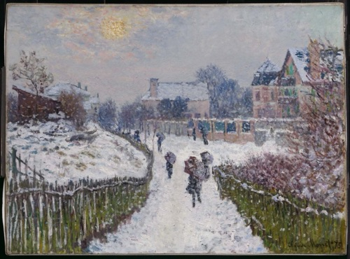](https://commons.wikimedia.org/wiki/File:Monet_-_Boulevard_Saint-Denis,_Argenteuil,_in_Winter,_1875.jpg) **Boulevard Saint-Denis, Argenteuil, in Winter, 1875** · 1875date QS:P571,+1875-00-00T00:00:00Z/9 Museum of Fine Arts, Boston · Public domain |
| [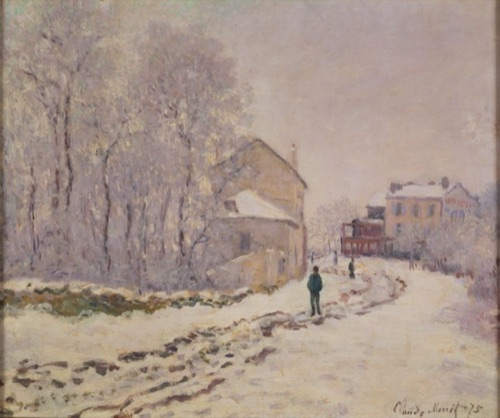](https://commons.wikimedia.org/wiki/File:Monet_Snow_at_Argenteuil.jpg) **Snow in Argenteuil** · 1875 National Museum of Western Art, Tokyo · Public domain | [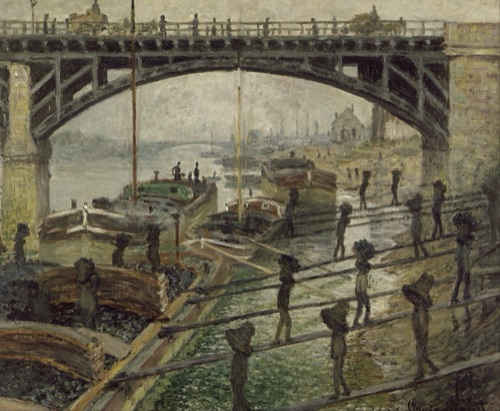](https://commons.wikimedia.org/wiki/File:Claude_Monet_-_The_Coalmen_-_Google_Art_Project.jpg) **The Coalmen** · 1875 Musée d'Orsay · Public domain | [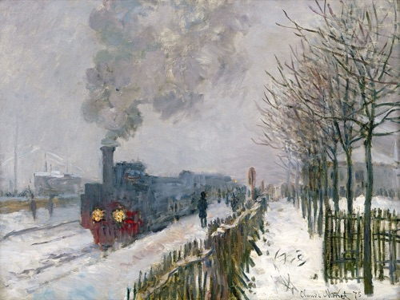](https://commons.wikimedia.org/wiki/File:Claude_Monet,_1875,_Train_in_the_Snow,_oil_on_canvas,_59_%C3%97_78_cm,_Mus%C3%A9e_Marmottan_Monet.jpg) **Train in the Snow** · 1875date QS:P571,+1875-00-00T00:00:00Z/9 Musée Marmottan Monet · Public domain |
| [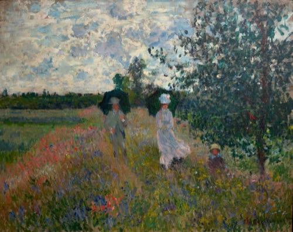](https://commons.wikimedia.org/wiki/File:%27En_promenade_pr%C3%A8s_d%27Argenteuil%27_by_Claude_Monet,_1875.jpg) **Walk near Argenteuil** · 1875date QS:P571,+1875-00-00T00:00:00Z/9 Musée Marmottan Monet · Public domain | [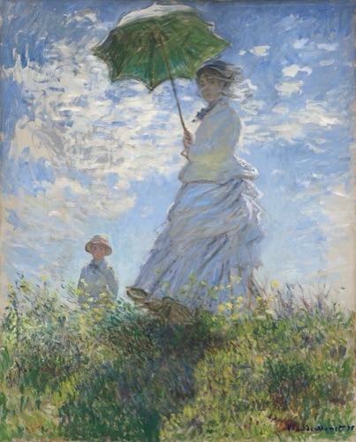](https://commons.wikimedia.org/wiki/File:Claude_Monet,_Woman_with_a_Parasol_-_Madame_Monet_and_Her_Son,_1875,_NGA_61379.jpg) **Woman with a Parasol - Madame Monet and Her Son** · 1875 National Gallery of Art · CC0 | [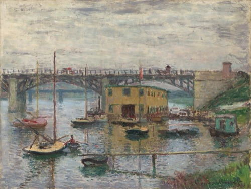](https://commons.wikimedia.org/wiki/File:Claude_Monet,_Bridge_at_Argenteuil_on_a_Gray_Day,_c._1876,_NGA_52188.jpg) **Bridge at Argenteuil on a Gray Day** · c. 1876 National Gallery of Art · Public domain |
| [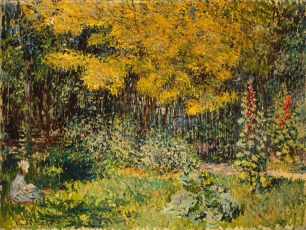](https://commons.wikimedia.org/wiki/File:Claude_Monet_%E2%80%93_Garden_(1876).jpg) **Garden** · 1876date QS:P571,+1876-00-00T00:00:00Z/9 State Hermitage Museum · Public domain | [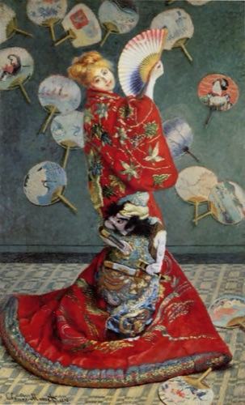](https://commons.wikimedia.org/wiki/File:Claude_Monet-Madame_Monet_en_costume_japonais.jpg) **Madame Monet en costume japonais** · 1876 Museum of Fine Arts, Boston · Public domain | [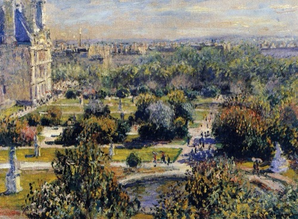](https://commons.wikimedia.org/wiki/File:Monet-Tuileries-Marmottan.jpg) **The Tuileries (Study** · 1876date QS:P571,+1876-00-00T00:00:00Z/9 Musée Marmottan Monet · Public domain |
| [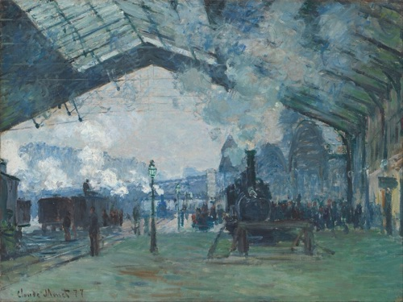](https://commons.wikimedia.org/wiki/File:Claude_Monet_-_Arrival_of_the_Normandy_Train,_Gare_Saint-Lazare_-_Google_Art_Project.jpg) **Arrival of the Normandy Train, Gare Saint-Lazare** · 1877 Art Institute of Chicago · Public domain | [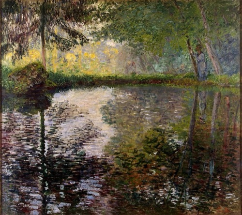](https://commons.wikimedia.org/wiki/File:Monet,_Pond-at-Montgeron.jpg) **Pond-at-Montgeron** · 1877date QS:P571,+1877-00-00T00:00:00Z/9 State Hermitage Museum · Public domain | [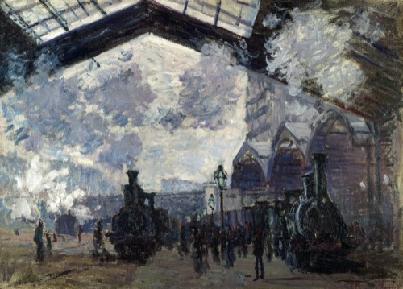](https://commons.wikimedia.org/wiki/File:Claude_Monet,_The_Gare_St-Lazare,_1877.jpg) **The Gare St-Lazare** · 1877date QS:P571,+1877-00-00T00:00:00Z/9 The National Gallery, London · Public domain |
| [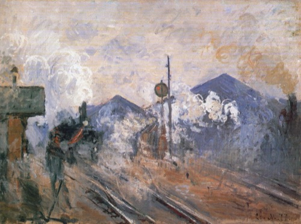](https://commons.wikimedia.org/wiki/File:Claude_Monet_-_Train_Tracks_at_the_Saint-Lazare_Station.jpg) **Train Tracks at the Saint-Lazare Station** · 1877date QS:P571,+1877-00-00T00:00:00Z/9 Pola Museum of Art · Public domain |  **Truthähne** · 1877date QS:P571,+1877-00-00T00:00:00Z/9 Musée d'Orsay · Public domain |  **Effet de neige à Vétheul** · 1878-79 Musée d'Orsay · Public domain |
|  **Spring by the Seine** · 1878 National Museum, Norway · Public domain |  **Portrait de Michel Monet bébé** · 1879 Musée Marmottan Monet · Public domain | — |

## 1880s · 45 件

| 作品 | 作品 | 作品 |
|:---|:---|:---|
|  **Banks of the Seine, Vétheuil** · 1880 National Gallery of Art · CC0 | .jpg) **Le Givre Frost** · 1880date QS:P571,+1880-00-00T00:00:00Z/9 Musée d'Orsay · Public domain |  **Road of La Roche-Guyon** · 1880date QS:P571,+1880-00-00T00:00:00Z/9 National Museum of Western Art, Tokyo · Public domain |
|  **The Willows** · 1880 National Gallery of Art · CC0 |  **Woman Seated under the Willows** · 1880 National Gallery of Art · CC0 |  **Flower Beds at Vétheuil** · 1881date QS:P571,+1881-00-00T00:00:00Z/9 Museum of Fine Arts, Boston · Public domain |
|  **Lavacourt under Snow** · 1881date QS:P571,+1881-00-00T00:00:00Z/9 The National Gallery, London · Public domain |  **Temps calme, Pourville** · 1881date QS:P571,+1881-00-00T00:00:00Z/9 Kunstmuseum Basel · Public domain |  **The Artist's Garden at Vétheuil** · 1881 National Gallery of Art · CC0 |
|  **Cliff Walk at Pourville** · 1882 Art Institute of Chicago · Public domain |  **Cliffs at Pourville** · 1882 National Gallery of Art · CC0 | .jpg) **La Falaise à Dieppe** · 1882date QS:P571,+1882-00-00T00:00:00Z/9 Kunsthaus Zürich · Public domain |
|  **La plage à Pourville, soleil couchant** · 1882-01-01 Musée Marmottan Monet · Public domain |  **Low Tide at Pourville, near Dieppe, 1882** · 1882 Cleveland Museum of Art · CC0 |  **Road at La Cavée, Pourville** · 1882date QS:P571,+1882-00-00T00:00:00Z/9 Museum of Fine Arts, Boston · Public domain |
|  **Shadows on the Sea. The Cliffs at Pourville** · 1882date QS:P571,+1882-00-00T00:00:00Z/9 Ny Carlsberg Glyptotek · Public domain |  **Michel Monet au chandail bleu** · 1883 Musée Marmottan Monet · Public domain |  **Étretat, der Strand und La Porte d'Amont** · 1883date QS:P571,+1883-00-00T00:00:00Z/9 Musée d'Orsay · Public domain |
|  **'Garden at Bordighera, Impression of Morning' by Claude Monet, 1884, Hermitage** · 1884date QS:P571,+1884-00-00T00:00:00Z/9 State Hermitage Museum · Public domain |  **Cap Martin, near Menton** · 1884 Museum of Fine Arts, Boston · Public domain |  **Haystacks at Giverny** · 1884 Pola Museum of Art · Public domain |
| .jpg) **La Corniche near Monaco** · 1884date QS:P571,+1884-00-00T00:00:00Z/9 Rijksmuseum · Public domain |  **Vallée de Sasso. Effet de soleil** · 1884date QS:P571,+1884-00-00T00:00:00Z/9 Musée Marmottan Monet · Public domain |  **'The Beach at Étretat' by Claude Monet, 1885-86, Pushkin Museum** · 1885 Pushkin State Museum of Fine Arts · Public domain |
|  **Boats on the Beach at Étretat** · 1885 Art Institute of Chicago · Public domain | _de_Claude_Monet_(W_1023)_-_Kunsthaus_Zurich.jpg) **Chaumière normande (1885) de Claude Monet (W 1023) - Kunsthaus Zurich** · 1885date QS:P571,+1885-00-00T00:00:00Z/9 Kunsthaus Zürich · Public domain |  **Haystacks** · 1885date QS:P571,+1885-00-00T00:00:00Z/9 馆藏待进一步核实 · Public domain |
|  **Le voilier, effet du soir** · 1885 Musée Marmottan Monet · Public domain |  **Poppy Field in a Hollow near Giverny** · 1885 Museum of Fine Arts, Boston · Public domain |  **The Departure of the Boats, Étretat** · 1885 Art Institute of Chicago · Public domain |
|  **Val de Falaise en hiver - MB 0007** · 1885 Kunsthaus Zürich · Public domain |  **Winter in Giverny** · 1885date QS:P571,+1885-00-00T00:00:00Z/9 Pola Museum of Art · Public domain |  **Étretat, The Beach and the Falaise d'Amont** · 1885 Art Institute of Chicago · Public domain |
|  **Champ de tulipes en Hollande** · 1886 Musée Marmottan Monet · Public domain |  **Claude - Haystack at Giverny** · 1886date QS:P571,+1886-00-00T00:00:00Z/9 State Hermitage Museum · Public domain |  **Meadow at Giverny** · 1886date QS:P571,+1886-00-00T00:00:00Z/9 Museum of Fine Arts, Boston · Public domain |
|  **Portrait de Poly (Hippolyte Guillaume, homardier à Belle-Île-en Mer** · 1886date QS:P571,+1886-00-00T00:00:00Z/9 Musée Marmottan Monet · Public domain |  **Rain, Étretat - NG.M.00368** · 1886 National Museum, Norway · Public domain |  **En Norvégienne. La barque à Giverny** · circa 1887date QS:P571,+1887-00-00T00:00:00Z/9,P1480,Q5727902 Musée d'Orsay · Public domain |
|  **On the Boat** · 1887date QS:P571,+1887-00-00T00:00:00Z/9 National Museum of Western Art, Tokyo · Public domain |  **Peony Garden** · 1887 National Museum of Western Art, Tokyo · Public domain |  **'Meadows at Giverny' by Claude Monet, 1888, Hermitage** · 1888date QS:P571,+1888-00-00T00:00:00Z/9 State Hermitage Museum · Public domain |
|  **Gardener's House at Antibes** · 1888 Cleveland Museum of Art · CC0 |  **Morning Haze** · 1888 National Gallery of Art · CC0 | _-_Google_Art_Project.jpg) **Valley of the Creuse (Gray Day** · 1889date QS:P571,+1889-00-00T00:00:00Z/9 Museum of Fine Arts, Boston · Public domain |

## 1890s · 34 件

| 作品 | 作品 | 作品 |
|:---|:---|:---|
|  **Poplars on the River Epte** · from 1890 until 1891date QS:P571,+1890-00-00T00:00:00Z/8,P580,+1890-00 The National Gallery, London · Public domain |  **Stack of Wheat** · 1890-1891 Art Institute of Chicago · Public domain | _-_1983.166_-_Art_Institute_of_Chicago.jpg) **Stack of Wheat (Thaw, Sunset** · 1890-1891 Art Institute of Chicago · Public domain |
| _-_1985.1103_-_Art_Institute_of_Chicago.jpg) **Stacks of Wheat (End of Summer** · 1890-1891 Art Institute of Chicago · Public domain | _-_1922.431_-_Art_Institute_of_Chicago.jpg) **Stacks of Wheat (Sunset, Snow Effect** · 1890-1891 Art Institute of Chicago · Public domain |  **Haystack in the Evening Sun** · 1891 馆藏待进一步核实 · Public domain |
|  **Poplars in the Sun** · 1891date QS:P571,+1891-00-00T00:00:00Z/9 National Museum of Western Art, Tokyo · Public domain |  **Wheatstack at Sunset** · 1891 馆藏待进一步核实 · Public domain | .JPG) **Rouen Cathedral, Façade (Sunset)** · {Date 1892} Musée Marmottan Monet · Public domain |
|  **Rouen Cathedral: setting sun** · 1892–1894 Amgueddfa Cymru – Museum Wales · CC0 |  **Die Kathedrale von Rouen - Portal und Albanturm in der Dämmerung** · 1893 Museum of Fine Arts, Boston · Public domain |  **Haystack** · 1893 馆藏待进一步核实 · Public domain |
| _Claude_Monet_(W_1349).jpg) **Rouen Cathedral in the Fog** · 1893 馆藏待进一步核实 · Public domain |  **Rouen Cathedral, Façade** · 1893date QS:P571,+1893-00-00T00:00:00Z/9 Museum of Fine Arts, Boston · Public domain |  **La Cathédrale de Rouen, le matin (dominante rose)** · 1894 馆藏待进一步核实 · Public domain |
| _-_Google_Art_Project.jpg) **Rouen Cathedral Façade and Tour d'Albane (Morning Effect** · 1894date QS:P571,+1894-00-00T00:00:00Z/9 Museum of Fine Arts, Boston · Public domain |  **Rouen Cathedral, West Façade** · 1894 National Gallery of Art · Public domain |  **Rouen Cathedral, West Façade, Sunlight** · 1894 National Gallery of Art · Public domain |
| _MET_DT2185.jpg) **Rouen Cathedral: The Portal (Sunlight)** · 1894date QS:P571,+1894-00-00T00:00:00Z/9 馆藏待进一步核实 · CC0 |  **Le Mont Kolsaas en Norvège** · 1895date QS:P571,+1895-00-00T00:00:00Z/9 Musée Marmottan Monet · Public domain |  **Les maisons bleues - Marmottan** · 1895 Musée Marmottan Monet · Public domain |
|  **Maisons rouges à Bjoernegaard** · 1895date QS:P571,+1895-00-00T00:00:00Z/9 Musée Marmottan Monet · Public domain |  **Mount Kolsås** · 1895 National Museum, Norway · Public domain |  **Flood at Giverny** · 1896 ; 2012-05-12 09:35:51 Ny Carlsberg Glyptotek · Public domain |
|  **Morning on the Seine by Claude Monet** · 1896 Museum of Fine Arts, Boston · Public domain |  **'Cliffs near Dieppe' by Claude Monet, 1897, Hermitage** · 1897date QS:P571,+1897-00-00T00:00:00Z/9 State Hermitage Museum · Public domain |  **Bras de Seine près de Giverny, soleil levant** · 1897 Musée Marmottan Monet · Public domain |
|  **Heavy Sea at Pourville** · 1897date QS:P571,+1897-00-00T00:00:00Z/9 National Museum of Western Art, Tokyo · Public domain |  **The Seine at Giverny** · 1897 National Gallery of Art · Public domain |  **Morning on the Seine** · 1898date QS:P571,+1898-00-00T00:00:00Z/9 National Museum of Western Art, Tokyo · Public domain |
| .jpg) **Le Bassin aux nymphéas, harmonie verte The Water-Lily Pond** · 1899date QS:P571,+1899-00-00T00:00:00Z/9 The National Gallery, London · Public domain |  **The Japanese Footbridge** · 1899 National Gallery of Art · CC0 |  **Water Lilies and Japanese Bridge** · 1899date QS:P571,+1899-00-00T00:00:00Z/9 Musée d'Orsay · Public domain |
|  **White Water Lilies** · 1899date QS:P571,+1899-00-00T00:00:00Z/9 Pushkin State Museum of Fine Arts · Public domain | — | — |

## 1900s · 23 件

| 作品 | 作品 | 作品 |
|:---|:---|:---|
|  **Charing Cross bridge** · 1900date QS:P571,+1900-00-00T00:00:00Z/9 Museum of Fine Arts, Boston · Public domain |  **Houses of Parliament, London** · 1900-1903 Art Institute of Chicago · CC0 |  **Houses of Parliament, Symphony in Rose** · 1900date QS:P571,+1900-00-00T00:00:00Z/9 Pola Museum of Art · Public domain |
|  **Water Lily Pond** · 1900 Art Institute of Chicago · Public domain |  **Vétheuil** · 1901 Art Institute of Chicago · Public domain |  **Charing Cross Bridge** · 1902date QS:P571,+1902-00-00T00:00:00Z/9 Amgueddfa Cymru – Museum Wales · CC0 |
|  **Le Pont de Waterloo** · 1902 Kunsthaus Zürich · Public domain |  **Vétheuil** · 1902date QS:P571,+1902-00-00T00:00:00Z/9 National Museum of Western Art, Tokyo · Public domain |  **The Houses of Parliament, Sunset** · 1903 National Gallery of Art · CC0 |
|  **Waterloo Bridge, Gray Day** · 1903 National Gallery of Art · CC0 |  **Le Parlement, coucher de soleil - 1995-0003** · 1904 Kunsthaus Zürich · Public domain |  **Seagulls, the River Thames and the Houses of Parliament** · 1904date QS:P571,+1904-00-00T00:00:00Z/9 Pushkin State Museum of Fine Arts · Public domain |
|  **Waterloo Bridge, London, at Dusk** · 1904 National Gallery of Art · CC0 |  **Waterloo Bridge, London, at Sunset** · 1904 National Gallery of Art · CC0 |  **London, Parliament, Reflections on the Thames** · 1905date QS:P571,+1905-00-00T00:00:00Z/9 Musée Marmottan Monet · Public domain |
| .jpg) **Water Lilies** · 1905date QS:P571,+1905-00-00T00:00:00Z/9 Museum of Fine Arts, Boston · Public domain |  **Waterlilies** · 1905date QS:P571,+1905-00-00T00:00:00Z/9 Amgueddfa Cymru – Museum Wales · CC0 |  **Le Palais Ducal vu de Saint-Georges Majeur - 1995-0004** · 1908 Kunsthaus Zürich · Public domain |
|  **Palazzo da Mula, Venice** · 1908 National Gallery of Art · CC0 |  **San Giorgio Maggiore** · 1908date QS:P571,+1908-00-00T00:00:00Z/9 Amgueddfa Cymru – Museum Wales · CC0 |  **San Giorgio Maggiore, Twilight** · 1908date QS:P571,+1908-00-00T00:00:00Z/9 Amgueddfa Cymru – Museum Wales · CC0 |
|  **The Palazzo Dario** · 1908date QS:P571,+1908-00-00T00:00:00Z/9 Amgueddfa Cymru – Museum Wales · CC0 |  **Waterlilies** · 1908date QS:P571,+1908-00-00T00:00:00Z/9 Amgueddfa Cymru – Museum Wales · CC0 | — |

## 1910s · 5 件

| 作品 | 作品 | 作品 |
|:---|:---|:---|
|  **Water Lilies** · 1915date QS:P571,+1915-00-00T00:00:00Z/9 Musée Marmottan Monet · Public domain |  **Water Lilies (Agapanthus** · c. 1915–26 Cleveland Museum of Art · CC0 | _Claude_Monet_-_NMWA,_Tokyo_(W_1971).jpg) **Water Lilies, Reflections of Weeping Willows (1916) Claude Monet - NMWA, Tokyo (W 1971** · 1916 National Museum of Western Art, Tokyo · Public domain |
|  **Le Pont japonais** · 1918 Musée Marmottan Monet · Public domain |  **The Japanese Bridge by Claude Monet, 1919, Kunstmuseum Basel** · 1919date QS:P571,+1919-00-00T00:00:00Z/9 Kunstmuseum Basel · Public domain | — |

## 1920s · 2 件

| 作品 | 作品 | 作品 |
|:---|:---|:---|
|  **Le Pont japonais** · 1920sdate QS:P,+1920-00-00T00:00:00Z/8 Musée Marmottan Monet · Public domain |  **Roses** · 1925 Musée Marmottan Monet · Public domain | — |

