# 按标题所指明的光照／天气浏览

[图集首页](../gallery.md) · [分类标准](../TAXONOMY.md)

注意：仅在原始标题含有相应词时标注，未对画面的实际光照或气象进行鉴定。部分图片可能出现在多个类别。

## 日落／暮色 · 13 件

| 作品 | 作品 | 作品 |
|:---|:---|:---|
| [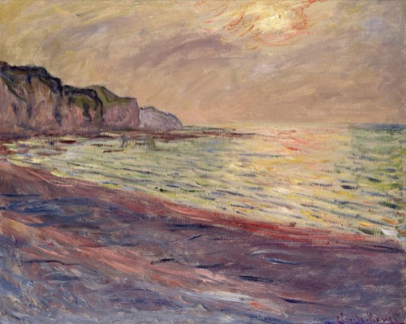](https://commons.wikimedia.org/wiki/File:La_plage_%C3%A0_Pourville,_soleil_couchant.jpg) **La plage à Pourville, soleil couchant** · 1882-01-01 Musée Marmottan Monet · Public domain | [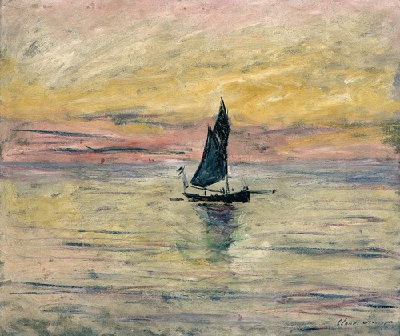](https://commons.wikimedia.org/wiki/File:Le_voilier,_effet_du_soir.jpg) **Le voilier, effet du soir** · 1885 Musée Marmottan Monet · Public domain | [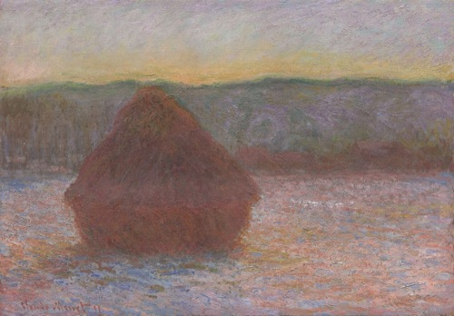](https://commons.wikimedia.org/wiki/File:Claude_Monet_-_Stack_of_Wheat_(Thaw,_Sunset)_-_1983.166_-_Art_Institute_of_Chicago.jpg) **Stack of Wheat (Thaw, Sunset** · 1890-1891 Art Institute of Chicago · Public domain |
| [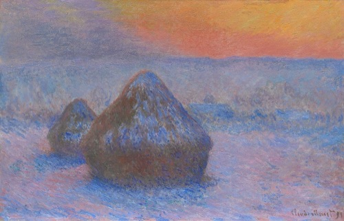](https://commons.wikimedia.org/wiki/File:Claude_Monet_-_Stacks_of_Wheat_(Sunset,_Snow_Effect)_-_1922.431_-_Art_Institute_of_Chicago.jpg) **Stacks of Wheat (Sunset, Snow Effect** · 1890-1891 Art Institute of Chicago · Public domain | [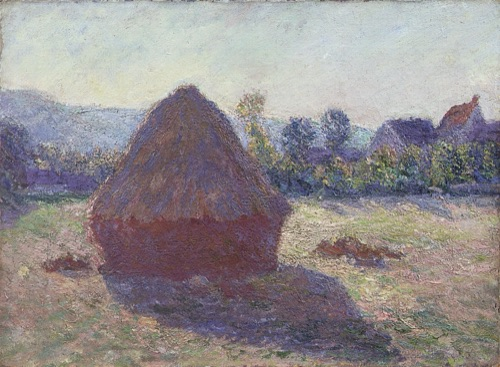](https://commons.wikimedia.org/wiki/File:Claude_Monet_-_Haystack_in_the_Evening_Sun_-_G%C3%B6sta_Serlachius_Fine_Arts_foundation.jpg) **Haystack in the Evening Sun** · 1891 馆藏待进一步核实 · Public domain |  **Wheatstack at Sunset** · 1891 馆藏待进一步核实 · Public domain |
| [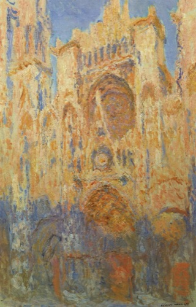](https://commons.wikimedia.org/wiki/File:Claude_Monet_-_Rouen_Cathedral,_Facade_(Sunset).JPG) **Rouen Cathedral, Façade (Sunset)** · {Date 1892} Musée Marmottan Monet · Public domain | [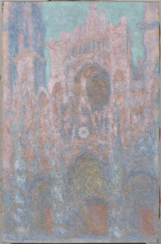](https://commons.wikimedia.org/wiki/File:Amgueddfa_Cymru_-_Eglwys_Gadeiriol_Rouen,_Machlud_Haul_-_Rouen_Cathedral,_setting_sun_-_220716.jpeg) **Rouen Cathedral: setting sun** · 1892–1894 Amgueddfa Cymru – Museum Wales · CC0 | [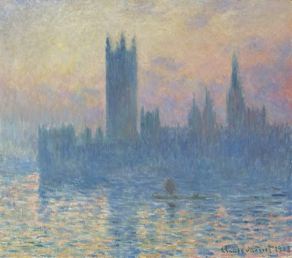](https://commons.wikimedia.org/wiki/File:Claude_Monet,_The_Houses_of_Parliament,_Sunset,_1903,_NGA_46523.jpg) **The Houses of Parliament, Sunset** · 1903 National Gallery of Art · CC0 |
| [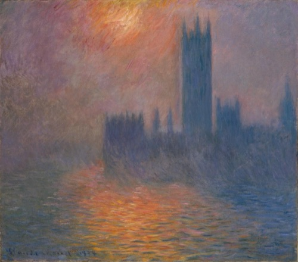](https://commons.wikimedia.org/wiki/File:Claude_Monet_-_Le_Parlement,_coucher_de_soleil_-_1995-0003_-_Kunsthaus_Z%C3%BCrich.jpg) **Le Parlement, coucher de soleil - 1995-0003** · 1904 Kunsthaus Zürich · Public domain | [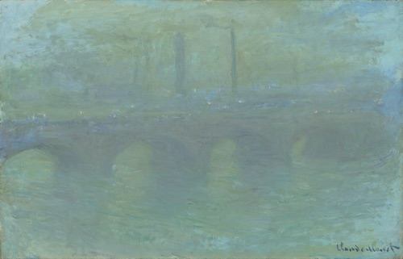](https://commons.wikimedia.org/wiki/File:Claude_Monet,_Waterloo_Bridge,_London,_at_Dusk,_1904,_NGA_61377.jpg) **Waterloo Bridge, London, at Dusk** · 1904 National Gallery of Art · CC0 | [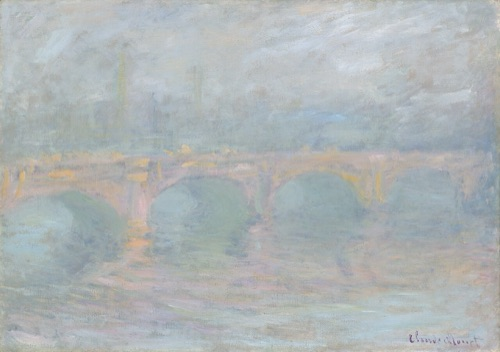](https://commons.wikimedia.org/wiki/File:Claude_Monet,_Waterloo_Bridge,_London,_at_Sunset,_1904,_NGA_61378.jpg) **Waterloo Bridge, London, at Sunset** · 1904 National Gallery of Art · CC0 |
| [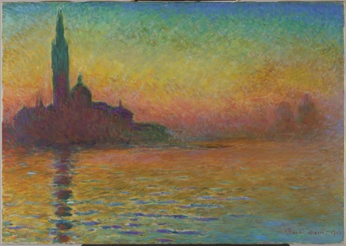](https://commons.wikimedia.org/wiki/File:Amgueddfa_Cymru_-_San_Giorgio_Maggiore_yn_y_Gwyll_-_San_Giorgio_Maggiore,_Twilight_-_220983.jpeg) **San Giorgio Maggiore, Twilight** · 1908date QS:P571,+1908-00-00T00:00:00Z/9 Amgueddfa Cymru – Museum Wales · CC0 | — | — |

## 清晨／黎明 · 8 件

| 作品 | 作品 | 作品 |
|:---|:---|:---|
| [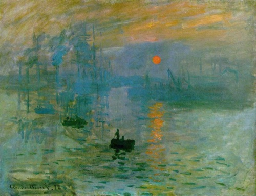](https://commons.wikimedia.org/wiki/File:Claude_Monet,_Impression,_soleil_levant,_1872.jpg) **Impression, soleil levant, 1872** · 1872 Musée Marmottan Monet · Public domain | [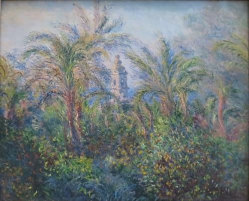](https://commons.wikimedia.org/wiki/File:%27Garden_at_Bordighera,_Impression_of_Morning%27_by_Claude_Monet,_1884,_Hermitage.JPG) **'Garden at Bordighera, Impression of Morning' by Claude Monet, 1884, Hermitage** · 1884date QS:P571,+1884-00-00T00:00:00Z/9 State Hermitage Museum · Public domain | [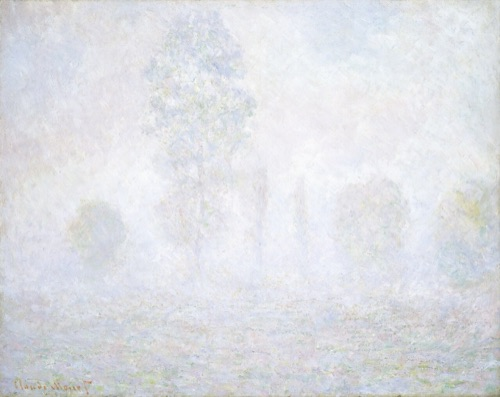](https://commons.wikimedia.org/wiki/File:Claude_Monet,_Morning_Haze,_1888,_NGA_45872.jpg) **Morning Haze** · 1888 National Gallery of Art · CC0 |
| [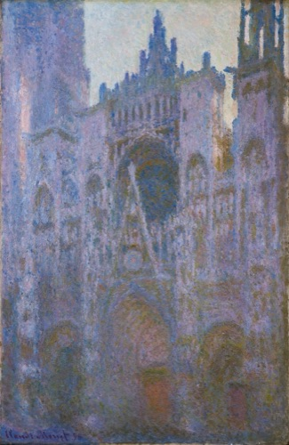](https://commons.wikimedia.org/wiki/File:Claude_Monet_-_La_Cathedrale_de_Rouen_Le_Matin,_dominante_rose_-_Goulandris_Museum.jpg) **La Cathédrale de Rouen, le matin (dominante rose)** · 1894 馆藏待进一步核实 · Public domain | [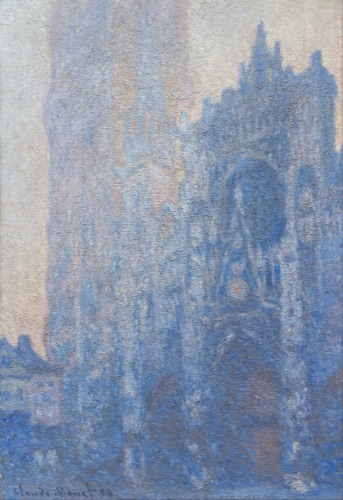](https://commons.wikimedia.org/wiki/File:Claude_Monet_-_Rouen_Cathedral_Fa%C3%A7ade_and_Tour_d%27Albane_(Morning_Effect)_-_Google_Art_Project.jpg) **Rouen Cathedral Façade and Tour d'Albane (Morning Effect** · 1894date QS:P571,+1894-00-00T00:00:00Z/9 Museum of Fine Arts, Boston · Public domain | [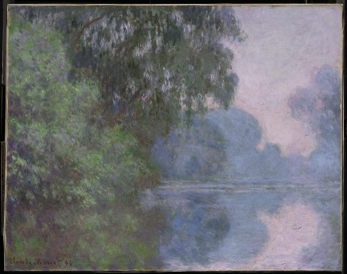](https://commons.wikimedia.org/wiki/File:Morning_on_the_Seine_by_Claude_Monet.jpg) **Morning on the Seine by Claude Monet** · 1896 Museum of Fine Arts, Boston · Public domain |
| [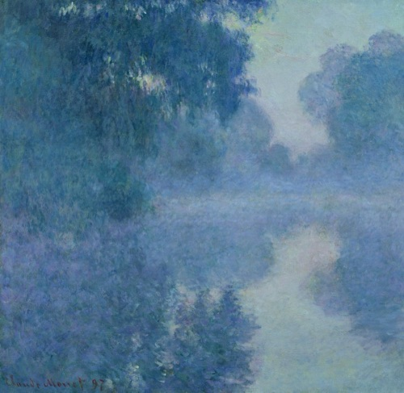](https://commons.wikimedia.org/wiki/File:Claude_Monet_-_Bras_de_Seine_pr%C3%A8s_de_Giverny,_soleil_levant_-_Mus%C3%A9e_Marmottan-Monet.jpg) **Bras de Seine près de Giverny, soleil levant** · 1897 Musée Marmottan Monet · Public domain | [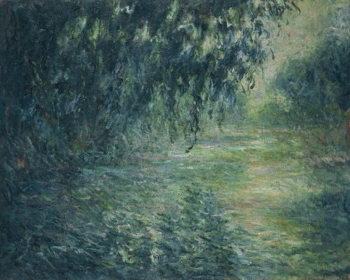](https://commons.wikimedia.org/wiki/File:Monet_Morning_on_the_Seine.jpg) **Morning on the Seine** · 1898date QS:P571,+1898-00-00T00:00:00Z/9 National Museum of Western Art, Tokyo · Public domain | — |

## 薄雾／雾气 · 3 件

| 作品 | 作品 | 作品 |
|:---|:---|:---|
| [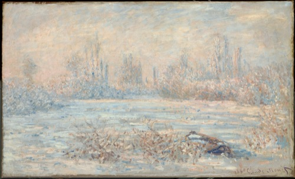](https://commons.wikimedia.org/wiki/File:Claude_Monet,_Le_Givre_(1880,_from_C2RMF).jpg) **Le Givre Frost** · 1880date QS:P571,+1880-00-00T00:00:00Z/9 Musée d'Orsay · Public domain |  **Morning Haze** · 1888 National Gallery of Art · CC0 | [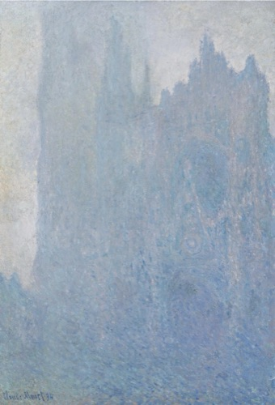](https://commons.wikimedia.org/wiki/File:La_Cath%C3%A9drale_dans_le_brouillard_(1894)_Claude_Monet_(W_1349).jpg) **Rouen Cathedral in the Fog** · 1893 馆藏待进一步核实 · Public domain |

## 雪／霜／冬季 · 9 件

| 作品 | 作品 | 作品 |
|:---|:---|:---|
| [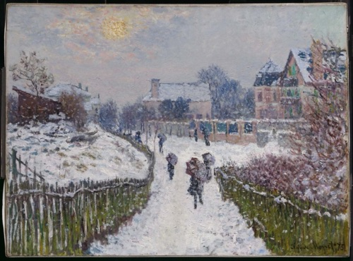](https://commons.wikimedia.org/wiki/File:Monet_-_Boulevard_Saint-Denis,_Argenteuil,_in_Winter,_1875.jpg) **Boulevard Saint-Denis, Argenteuil, in Winter, 1875** · 1875date QS:P571,+1875-00-00T00:00:00Z/9 Museum of Fine Arts, Boston · Public domain | [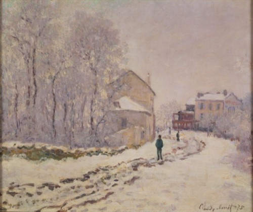](https://commons.wikimedia.org/wiki/File:Monet_Snow_at_Argenteuil.jpg) **Snow in Argenteuil** · 1875 National Museum of Western Art, Tokyo · Public domain | [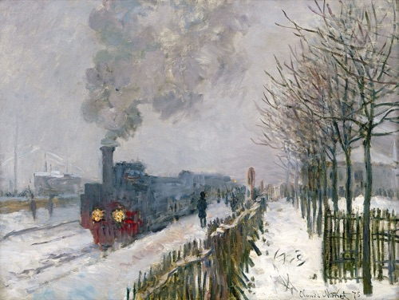](https://commons.wikimedia.org/wiki/File:Claude_Monet,_1875,_Train_in_the_Snow,_oil_on_canvas,_59_%C3%97_78_cm,_Mus%C3%A9e_Marmottan_Monet.jpg) **Train in the Snow** · 1875date QS:P571,+1875-00-00T00:00:00Z/9 Musée Marmottan Monet · Public domain |
| [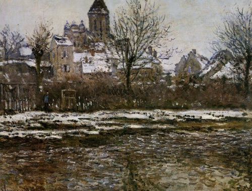](https://commons.wikimedia.org/wiki/File:Claude_Monet_-_Effet_de_neige_%C3%A0_V%C3%A9theul.jpg) **Effet de neige à Vétheul** · 1878-79 Musée d'Orsay · Public domain | .jpg) **Le Givre Frost** · 1880date QS:P571,+1880-00-00T00:00:00Z/9 Musée d'Orsay · Public domain | [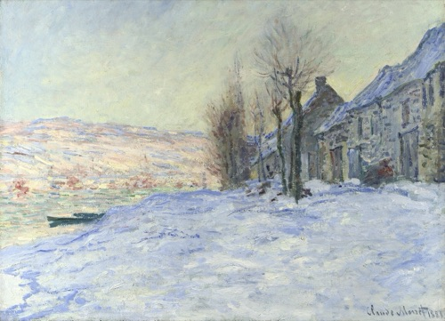](https://commons.wikimedia.org/wiki/File:Monet,_Lavacourt-Sunshine-and-Snow.jpg) **Lavacourt under Snow** · 1881date QS:P571,+1881-00-00T00:00:00Z/9 The National Gallery, London · Public domain |
| [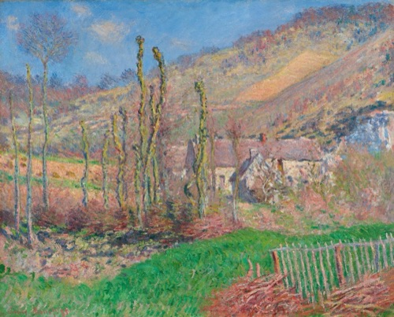](https://commons.wikimedia.org/wiki/File:Claude_Monet_-_Val_de_Falaise_en_hiver_-_MB_0007_-_Kunsthaus_Z%C3%BCrich.jpg) **Val de Falaise en hiver - MB 0007** · 1885 Kunsthaus Zürich · Public domain | [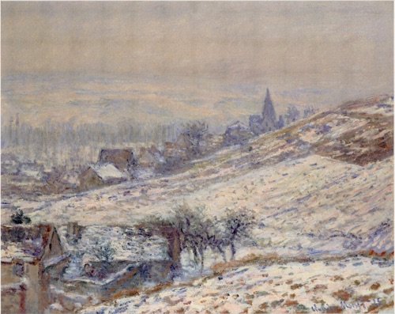](https://commons.wikimedia.org/wiki/File:ClaudeMonet-1885-Winter_in_Giverny.png) **Winter in Giverny** · 1885date QS:P571,+1885-00-00T00:00:00Z/9 Pola Museum of Art · Public domain | _-_1922.431_-_Art_Institute_of_Chicago.jpg) **Stacks of Wheat (Sunset, Snow Effect** · 1890-1891 Art Institute of Chicago · Public domain |

## 雨 · 5 件

| 作品 | 作品 | 作品 |
|:---|:---|:---|
| [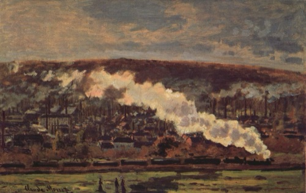](https://commons.wikimedia.org/wiki/File:Claude_Monet_-_The_Train.jpg) **The Goods Train** · 1872date QS:P571,+1872-00-00T00:00:00Z/9 Pola Museum of Art · Public domain |  **Train in the Snow** · 1875date QS:P571,+1875-00-00T00:00:00Z/9 Musée Marmottan Monet · Public domain | [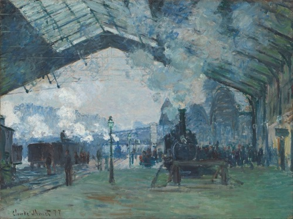](https://commons.wikimedia.org/wiki/File:Claude_Monet_-_Arrival_of_the_Normandy_Train,_Gare_Saint-Lazare_-_Google_Art_Project.jpg) **Arrival of the Normandy Train, Gare Saint-Lazare** · 1877 Art Institute of Chicago · Public domain |
| [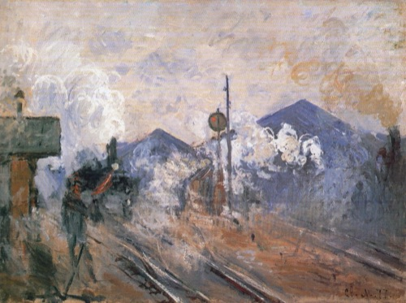](https://commons.wikimedia.org/wiki/File:Claude_Monet_-_Train_Tracks_at_the_Saint-Lazare_Station.jpg) **Train Tracks at the Saint-Lazare Station** · 1877date QS:P571,+1877-00-00T00:00:00Z/9 Pola Museum of Art · Public domain | [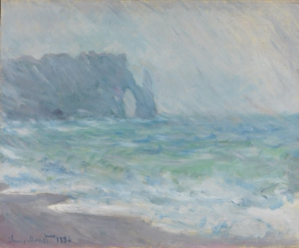](https://commons.wikimedia.org/wiki/File:Claude_Monet_-_Rain,_%C3%89tretat_-_NG.M.00368_-_National_Museum_of_Art,_Architecture_and_Design.jpg) **Rain, Étretat - NG.M.00368** · 1886 National Museum, Norway · Public domain | — |

## 日光 · 8 件

| 作品 | 作品 | 作品 |
|:---|:---|:---|
|  **Impression, soleil levant, 1872** · 1872 Musée Marmottan Monet · Public domain |  **La plage à Pourville, soleil couchant** · 1882-01-01 Musée Marmottan Monet · Public domain | [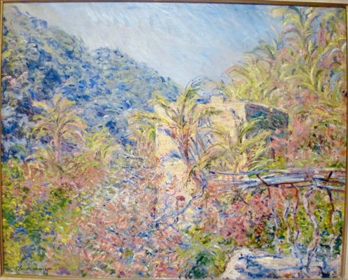](https://commons.wikimedia.org/wiki/File:Monet-Sasso-Marmottan.jpg) **Vallée de Sasso. Effet de soleil** · 1884date QS:P571,+1884-00-00T00:00:00Z/9 Musée Marmottan Monet · Public domain |
| .JPG) **Rouen Cathedral, Façade (Sunset)** · {Date 1892} Musée Marmottan Monet · Public domain | [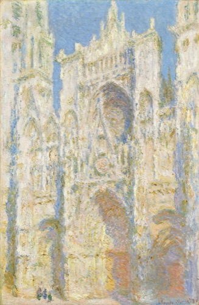](https://commons.wikimedia.org/wiki/File:Claude_Monet,_Rouen_Cathedral,_West_Fa%C3%A7ade,_Sunlight,_1894,_NGA_46654.jpg) **Rouen Cathedral, West Façade, Sunlight** · 1894 National Gallery of Art · Public domain | [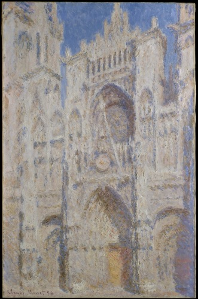](https://commons.wikimedia.org/wiki/File:Rouen_Cathedral-_The_Portal_(Sunlight)_MET_DT2185.jpg) **Rouen Cathedral: The Portal (Sunlight)** · 1894date QS:P571,+1894-00-00T00:00:00Z/9 馆藏待进一步核实 · CC0 |
|  **Bras de Seine près de Giverny, soleil levant** · 1897 Musée Marmottan Monet · Public domain |  **Le Parlement, coucher de soleil - 1995-0003** · 1904 Kunsthaus Zürich · Public domain | — |

## 阴天 · 3 件

| 作品 | 作品 | 作品 |
|:---|:---|:---|
| [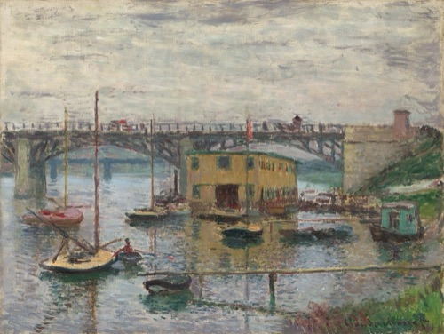](https://commons.wikimedia.org/wiki/File:Claude_Monet,_Bridge_at_Argenteuil_on_a_Gray_Day,_c._1876,_NGA_52188.jpg) **Bridge at Argenteuil on a Gray Day** · c. 1876 National Gallery of Art · Public domain | [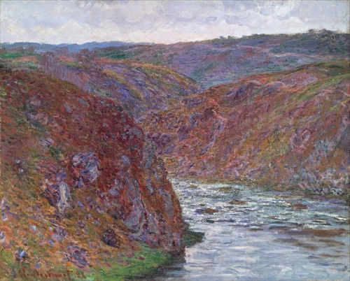](https://commons.wikimedia.org/wiki/File:Claude_Monet_-_Valley_of_the_Creuse_(Gray_Day)_-_Google_Art_Project.jpg) **Valley of the Creuse (Gray Day** · 1889date QS:P571,+1889-00-00T00:00:00Z/9 Museum of Fine Arts, Boston · Public domain | [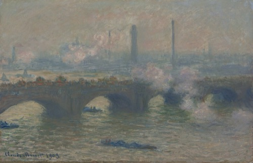](https://commons.wikimedia.org/wiki/File:Claude_Monet,_Waterloo_Bridge,_Gray_Day,_1903,_NGA_46658.jpg) **Waterloo Bridge, Gray Day** · 1903 National Gallery of Art · CC0 |

