# 莫奈原作视觉图集 · 41 件

[参考集说明](README.md) · [JSON 目录](catalog.json) · [图片授权](RIGHTS.md)

点击缩略图可查看馆藏网站或 Wikimedia Commons 文件页；高分辨率原始文件地址在 JSON 目录中。表格里的“观察”只是研究问题，不是已验证的生成风格规则。

## 1860–1879：12 件

| 作品 | 作品 | 作品 |
|:---|:---|:---|
| [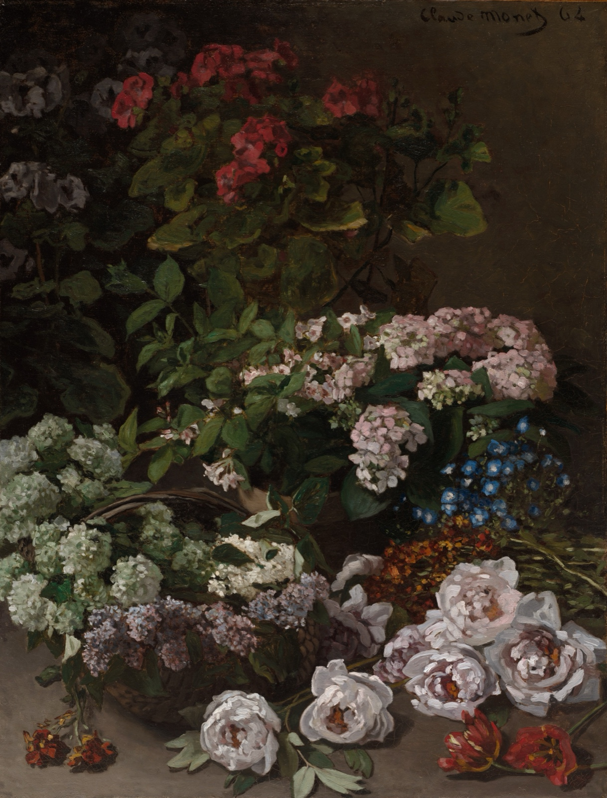](https://clevelandart.org/art/1953.155) **Spring Flowers** · 1864 Cleveland Museum of Art · CC0 观察：花卉与叶片的色块和局部笔触 | [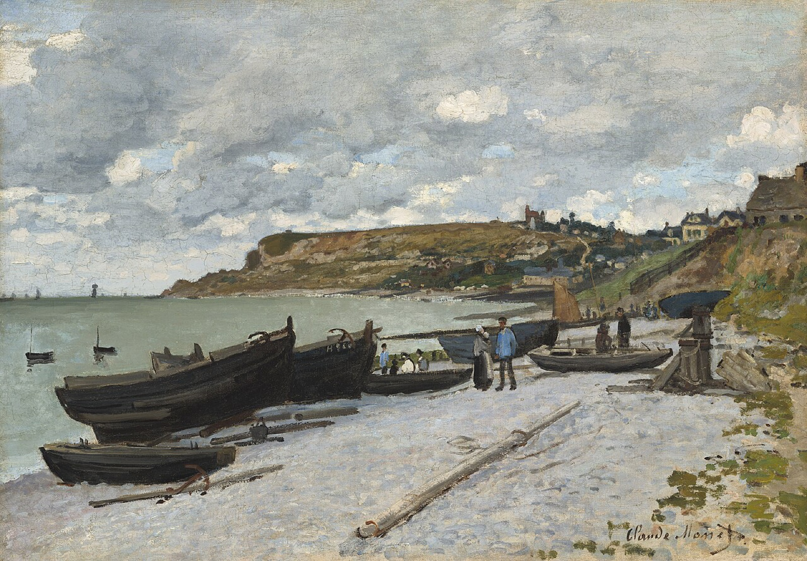](https://commons.wikimedia.org/wiki/File:Claude_Monet,_Sainte-Adresse,_1867,_NGA_71550.jpg) **Sainte-Adresse** · 1867 National Gallery of Art · CC0 观察：地形概括、植被轮廓与空间层次 | [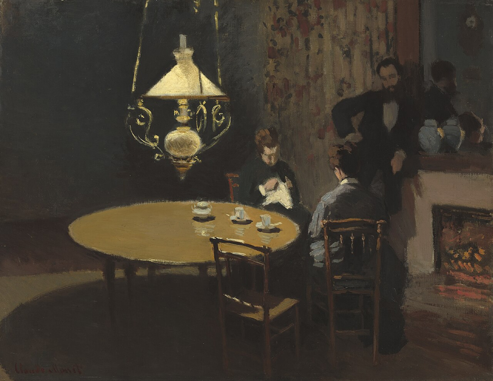](https://commons.wikimedia.org/wiki/File:Claude_Monet,_Interior,_after_Dinner,_1868-1869,_NGA_61376.jpg) **Interior, after Dinner** · 1868-1869 National Gallery of Art · CC0 观察：室内人物布局、体积与局部明暗 |
| [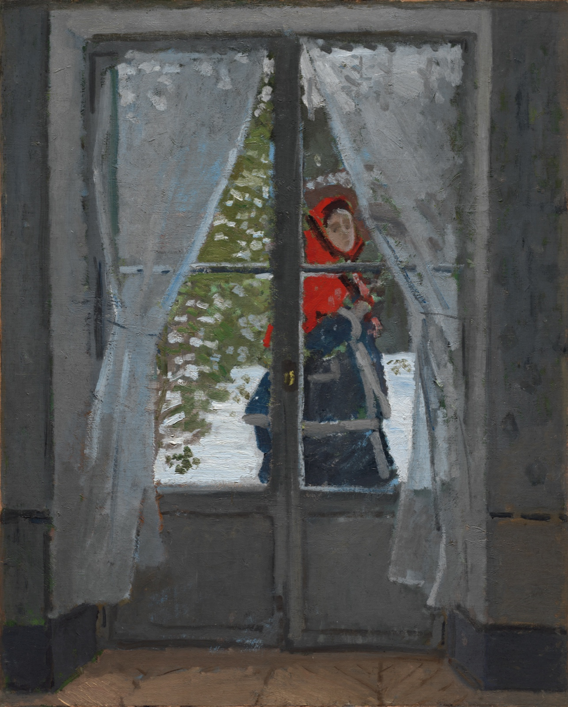](https://clevelandart.org/art/1958.39) **The Red Kerchief** · c. 1868–73 Cleveland Museum of Art · CC0 观察：人物与背景的笔触分工、边缘与受光面 | [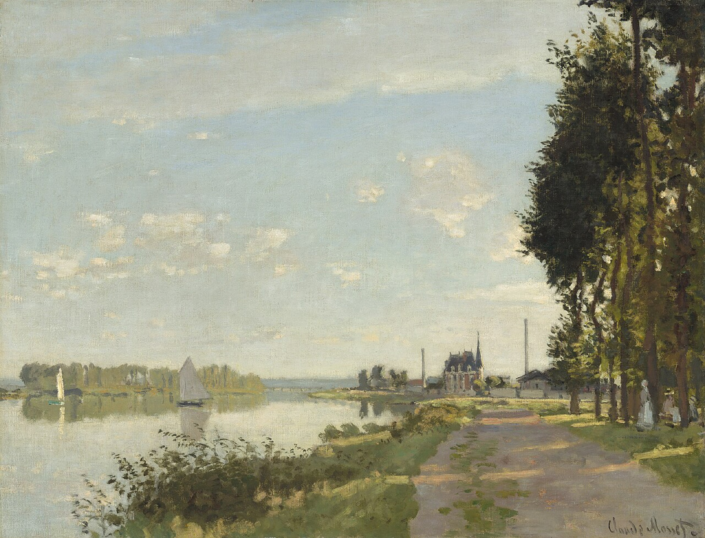](https://commons.wikimedia.org/wiki/File:Claude_Monet,_Argenteuil,_c._1872,_NGA_52186.jpg) **Argenteuil** · c. 1872 National Gallery of Art · CC0 观察：地形概括、植被轮廓与空间层次 | [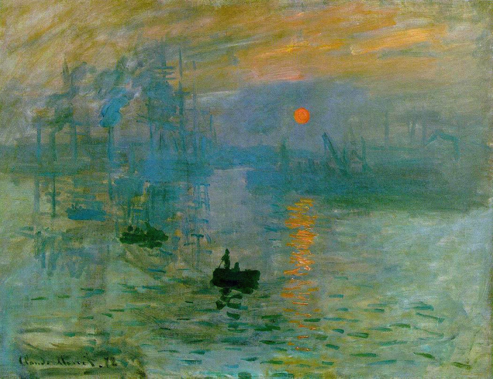](https://commons.wikimedia.org/wiki/File:Claude_Monet,_Impression,_soleil_levant,_1872.jpg) **Impression, soleil levant, 1872** · 1872 Musée Marmottan Monet · Public domain 观察：逆光、晨雾、色彩集中与大面积灰调 |
| [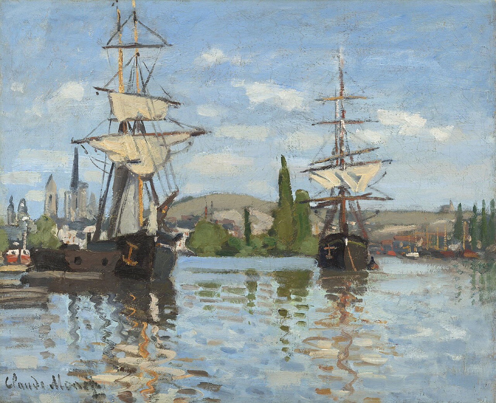](https://commons.wikimedia.org/wiki/File:Claude_Monet,_Ships_Riding_on_the_Seine_at_Rouen,_1872-1873,_NGA_52187.jpg) **Ships Riding on the Seine at Rouen** · 1872-1873 National Gallery of Art · Public domain 观察：水面笔触方向、岸线与远近色调 | [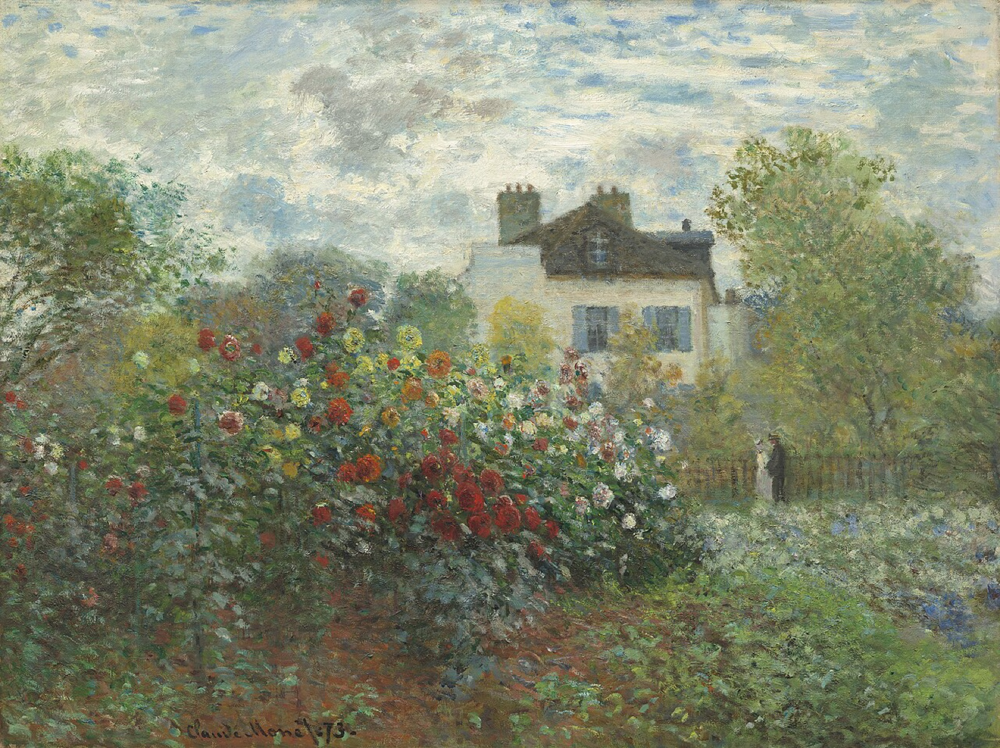](https://commons.wikimedia.org/wiki/File:Claude_Monet,_The_Artist%27s_Garden_in_Argenteuil_(A_Corner_of_the_Garden_with_Dahlias),_1873,_NGA_72138.jpg) **The Artist's Garden in Argenteuil (A Corner of the Garden with Dahlias)** · 1873 National Gallery of Art · CC0 观察：花草短笔触、局部颜色与空间组织 | [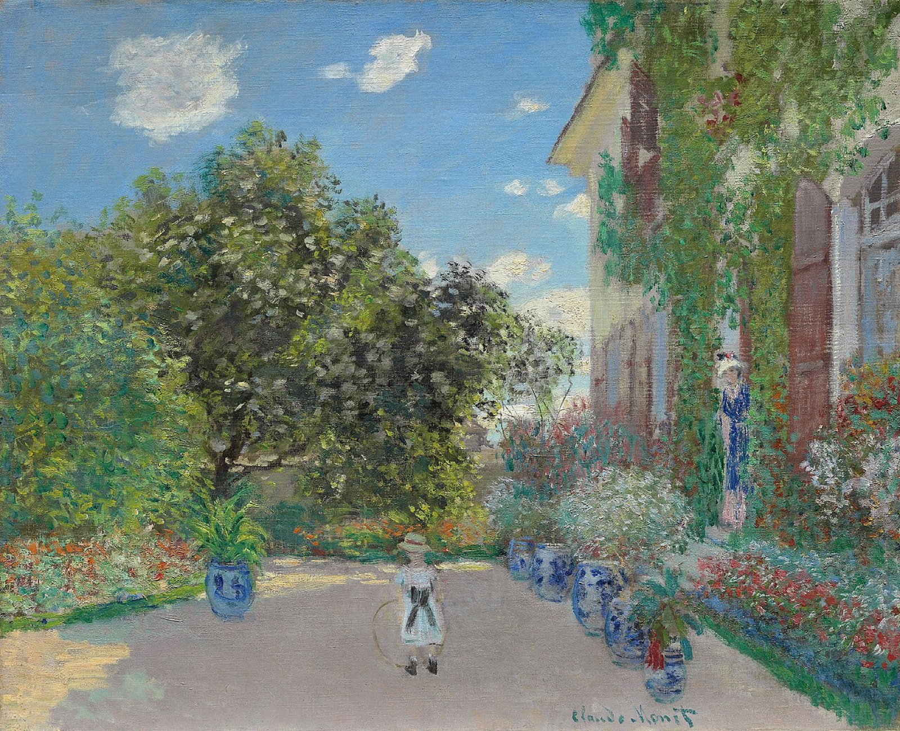](https://commons.wikimedia.org/wiki/File:Claude_Monet_-_The_Artist%27s_House_at_Argenteuil_-_1933.1153_-_Art_Institute_of_Chicago.jpg) **The Artist's House at Argenteuil** · 1873 Art Institute of Chicago · Public domain 观察：花草短笔触、局部颜色与空间组织 |
| [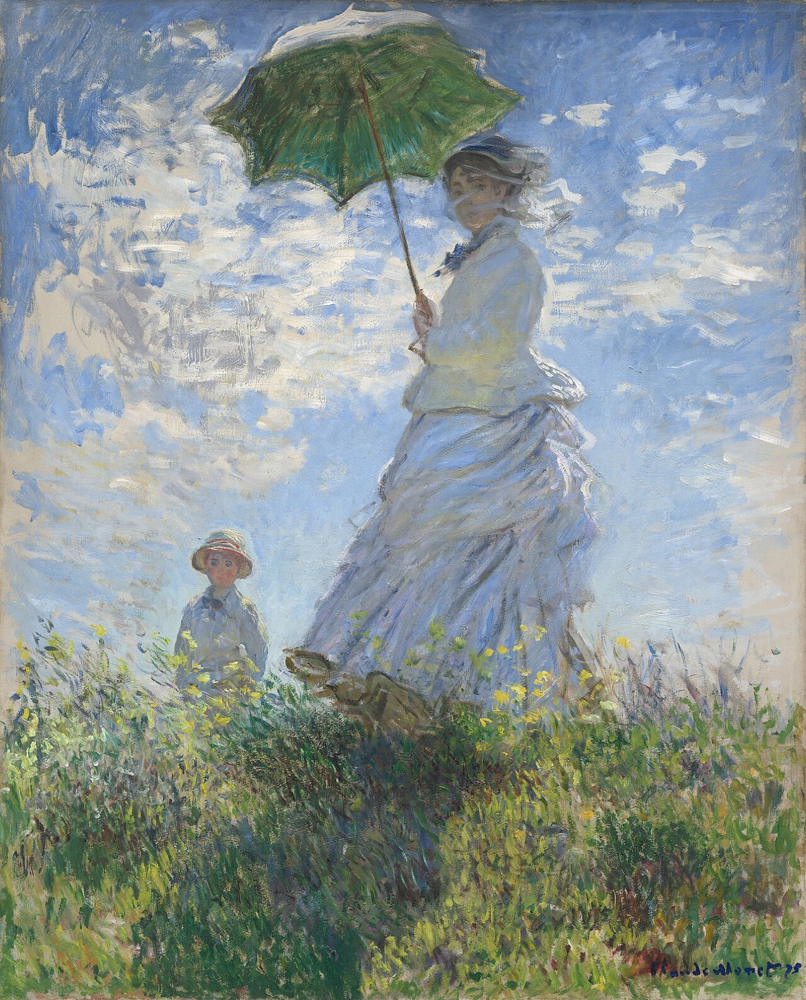](https://commons.wikimedia.org/wiki/File:Claude_Monet,_Woman_with_a_Parasol_-_Madame_Monet_and_Her_Son,_1875,_NGA_61379.jpg) **Woman with a Parasol - Madame Monet and Her Son** · 1875 National Gallery of Art · CC0 观察：人物与背景的笔触分工、边缘与受光面 | [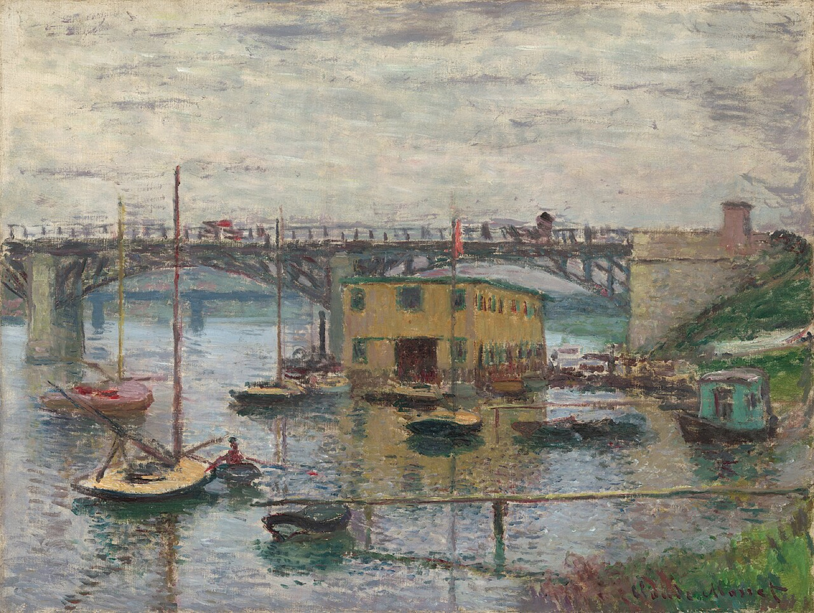](https://commons.wikimedia.org/wiki/File:Claude_Monet,_Bridge_at_Argenteuil_on_a_Gray_Day,_c._1876,_NGA_52188.jpg) **Bridge at Argenteuil on a Gray Day** · c. 1876 National Gallery of Art · Public domain 观察：桥梁结构与水面色彩相互作用 | [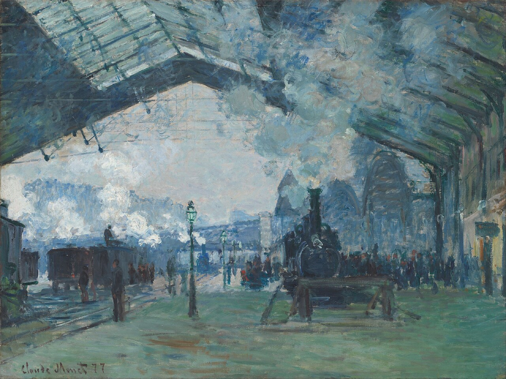](https://commons.wikimedia.org/wiki/File:Claude_Monet_-_Arrival_of_the_Normandy_Train,_Gare_Saint-Lazare_-_Google_Art_Project.jpg) **Arrival of the Normandy Train, Gare Saint-Lazare** · 1877 Art Institute of Chicago · Public domain 观察：蒸汽、铁轨结构与空间透视 |

## 1880–1889：12 件

| 作品 | 作品 | 作品 |
|:---|:---|:---|
| [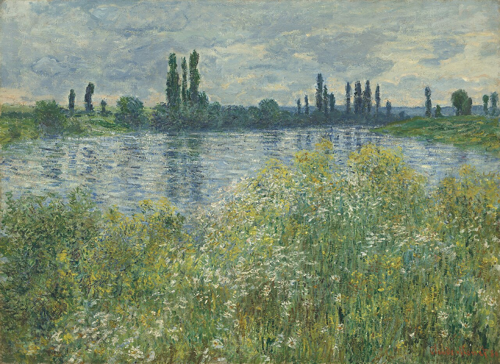](https://commons.wikimedia.org/wiki/File:Claude_Monet,_Banks_of_the_Seine,_V%C3%A9theuil,_1880,_NGA_46652.jpg) **Banks of the Seine, Vétheuil** · 1880 National Gallery of Art · CC0 观察：水面笔触方向、岸线与远近色调 | [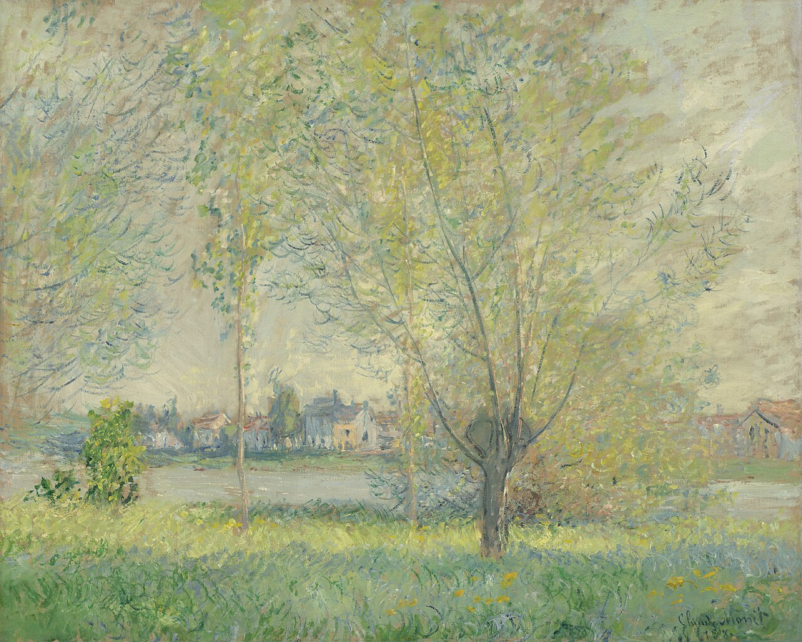](https://commons.wikimedia.org/wiki/File:Claude_Monet,_The_Willows,_1880,_NGA_178254.jpg) **The Willows** · 1880 National Gallery of Art · CC0 观察：地形概括、植被轮廓与空间层次 | [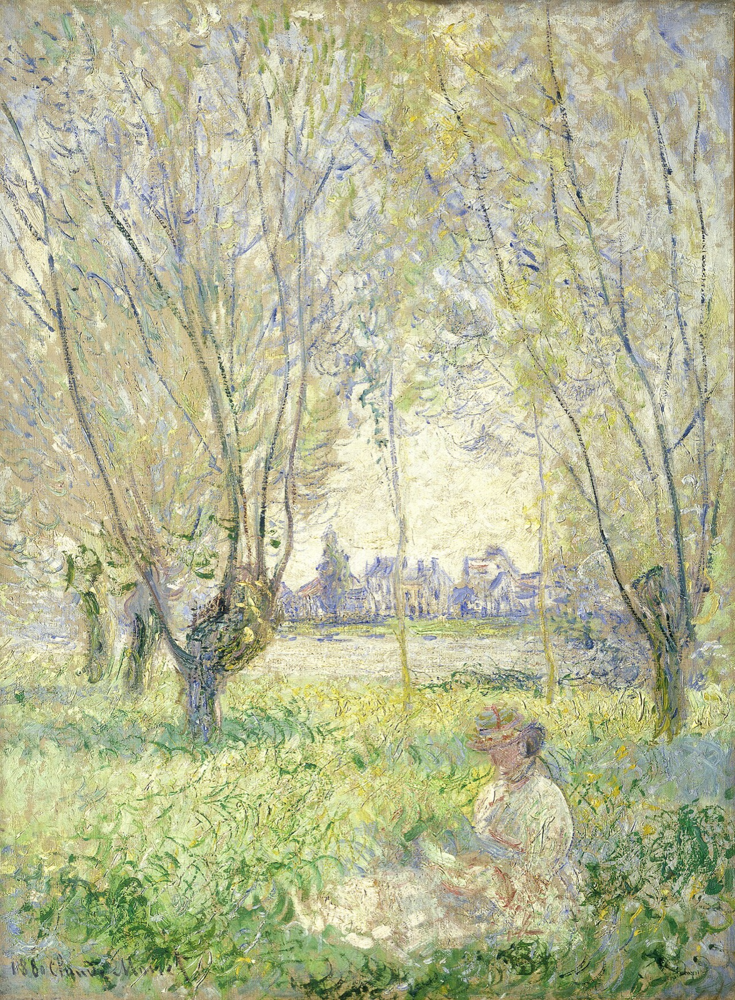](https://commons.wikimedia.org/wiki/File:Claude_Monet,_Woman_Seated_under_the_Willows,_1880,_NGA_46653.jpg) **Woman Seated under the Willows** · 1880 National Gallery of Art · CC0 观察：人物与背景的笔触分工、边缘与受光面 |
| [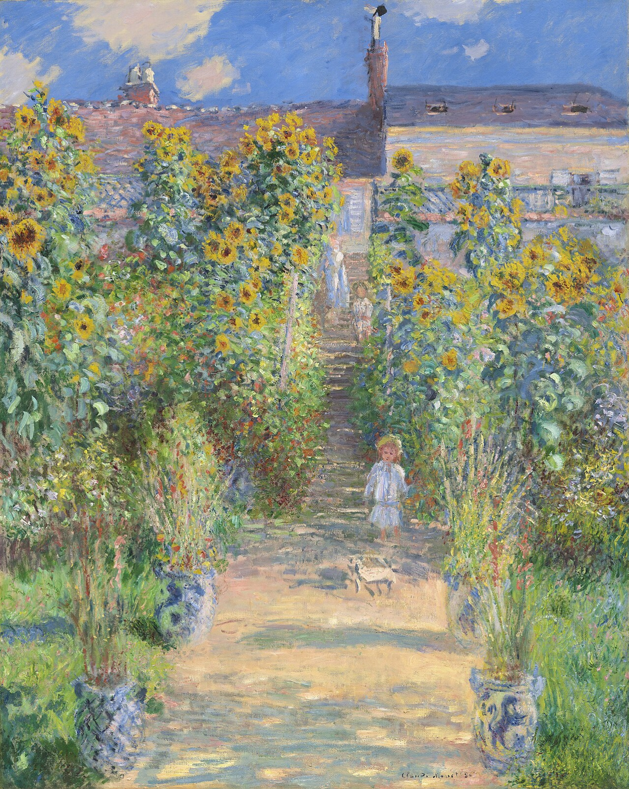](https://commons.wikimedia.org/wiki/File:Claude_Monet,_The_Artist%27s_Garden_at_V%C3%A9theuil,_1881,_NGA_52189.jpg) **The Artist's Garden at Vétheuil** · 1881 National Gallery of Art · CC0 观察：花草短笔触、局部颜色与空间组织 | [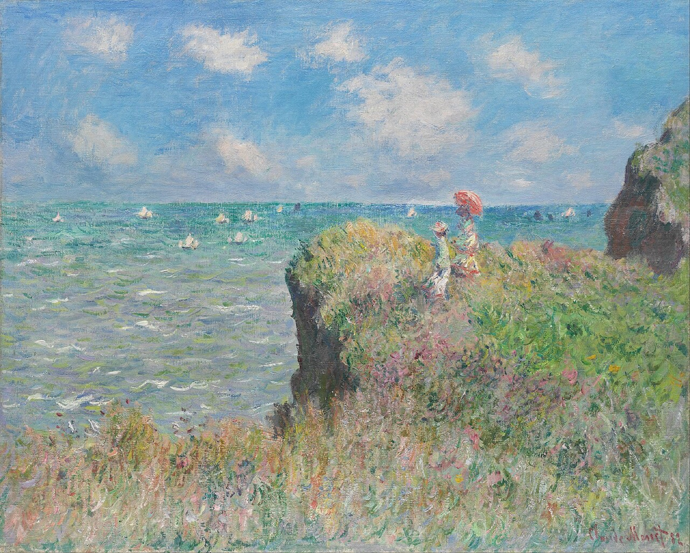](https://commons.wikimedia.org/wiki/File:Claude_Monet_-_Cliff_Walk_at_Pourville_-_Google_Art_Project.jpg) **Cliff Walk at Pourville** · 1882 Art Institute of Chicago · Public domain 观察：人物轮廓、海风和海岸明度关系 | [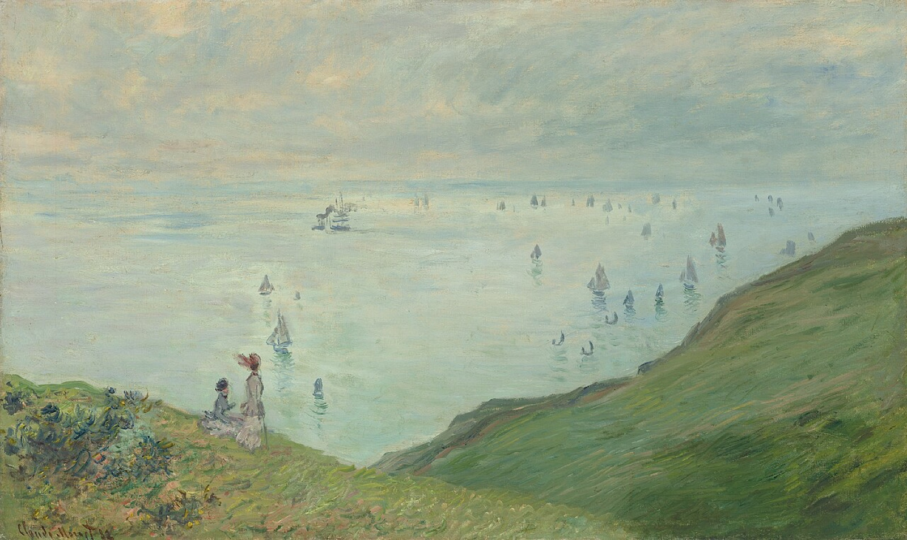](https://commons.wikimedia.org/wiki/File:Claude_Monet,_Cliffs_at_Pourville,_1882,_NGA_66425.jpg) **Cliffs at Pourville** · 1882 National Gallery of Art · CC0 观察：天空、海面、悬崖的笔触及结构差异 |
| [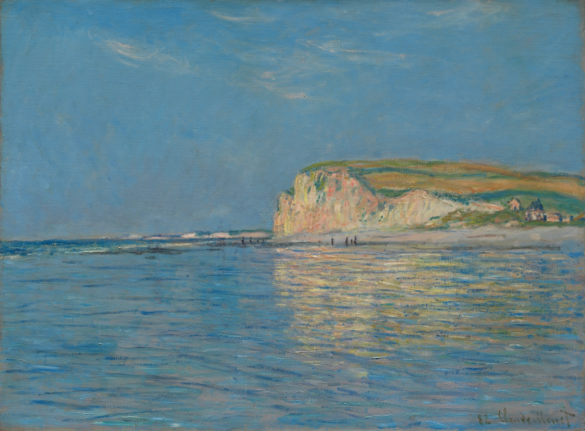](https://clevelandart.org/art/1947.196) **Low Tide at Pourville, near Dieppe, 1882** · 1882 Cleveland Museum of Art · CC0 观察：天空、海面、悬崖的笔触及结构差异 | [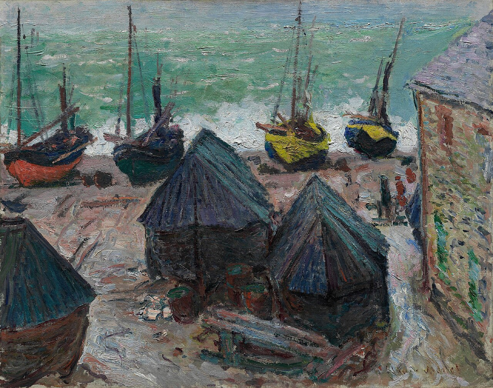](https://commons.wikimedia.org/wiki/File:Claude_Monet_-_Boats_on_the_Beach_at_%C3%89tretat_-_1947.95_-_Art_Institute_of_Chicago.jpg) **Boats on the Beach at Étretat** · 1885 Art Institute of Chicago · Public domain 观察：天空、海面、悬崖的笔触及结构差异 | [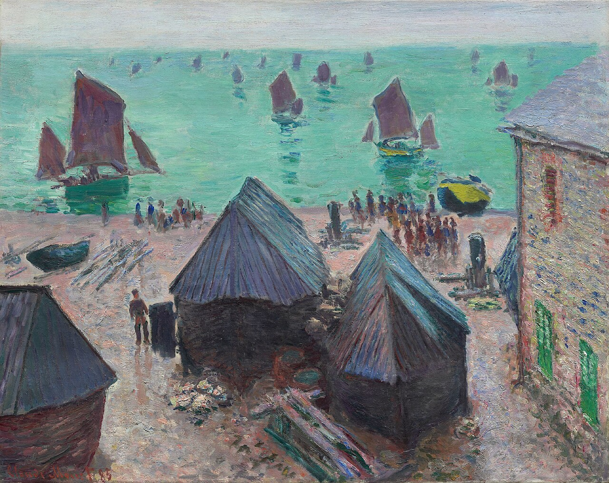](https://commons.wikimedia.org/wiki/File:Claude_Monet_-_The_Departure_of_the_Boats,_%C3%89tretat_-_1922.428_-_Art_Institute_of_Chicago.jpg) **The Departure of the Boats, Étretat** · 1885 Art Institute of Chicago · Public domain 观察：天空、海面、悬崖的笔触及结构差异 |
| [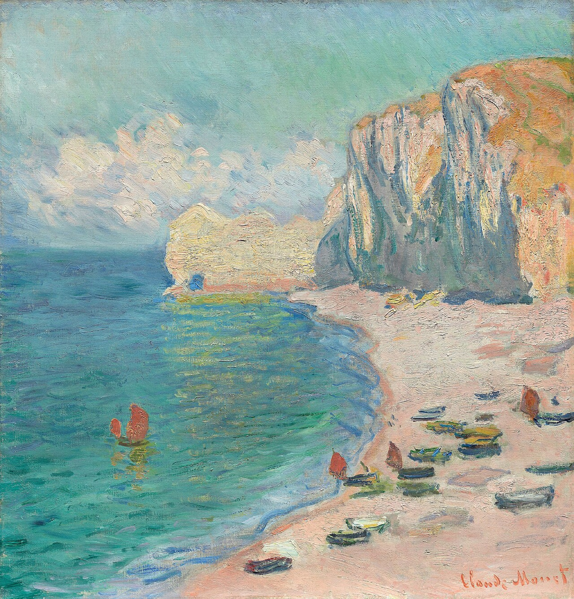](https://commons.wikimedia.org/wiki/File:Claude_Monet_-_%C3%89tretat,_The_Beach_and_the_Falaise_d%27Amont_-_1964.204_-_Art_Institute_of_Chicago.jpg) **Étretat, The Beach and the Falaise d'Amont** · 1885 Art Institute of Chicago · Public domain 观察：天空、海面、悬崖的笔触及结构差异 | [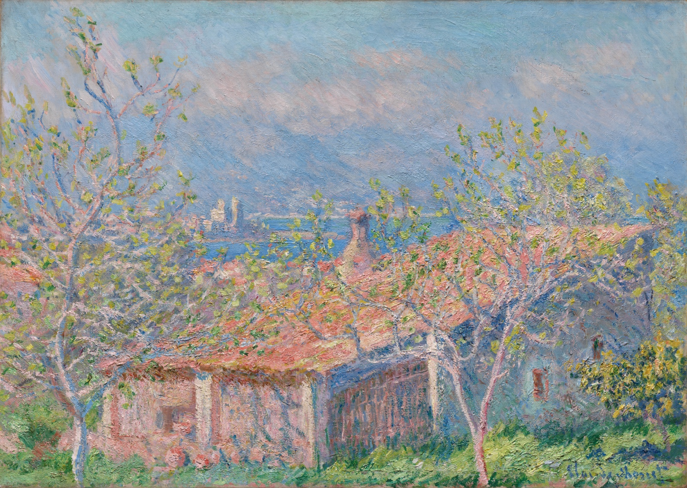](https://clevelandart.org/art/1916.1044) **Gardener's House at Antibes** · 1888 Cleveland Museum of Art · CC0 观察：花草短笔触、局部颜色与空间组织 | [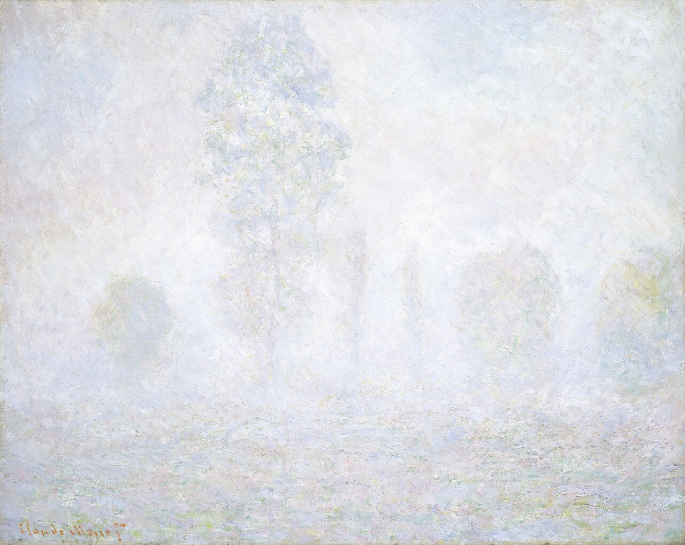](https://commons.wikimedia.org/wiki/File:Claude_Monet,_Morning_Haze,_1888,_NGA_45872.jpg) **Morning Haze** · 1888 National Gallery of Art · CC0 观察：雾气、空气透视及微妙明度变化 |

## 1890–1899：8 件

| 作品 | 作品 | 作品 |
|:---|:---|:---|
| [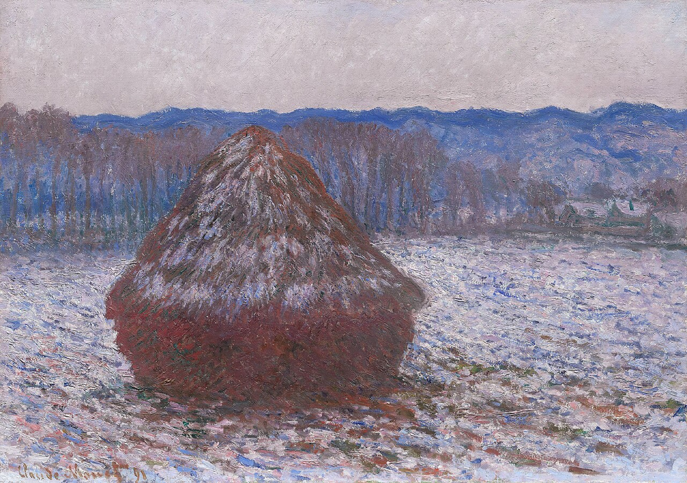](https://commons.wikimedia.org/wiki/File:Claude_Monet_-_Stack_of_Wheat_-_1983.29_-_Art_Institute_of_Chicago.jpg) **Stack of Wheat** · 1890-1891 Art Institute of Chicago · Public domain 观察：同一主体的时段、季节与阴影色温对照 | [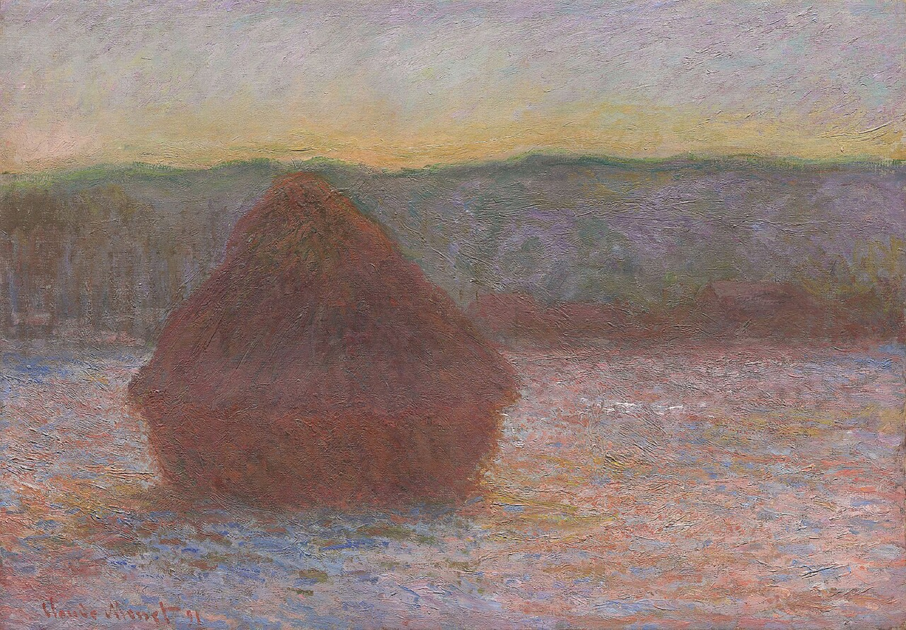](https://commons.wikimedia.org/wiki/File:Claude_Monet_-_Stack_of_Wheat_(Thaw,_Sunset)_-_1983.166_-_Art_Institute_of_Chicago.jpg) **Stack of Wheat (Thaw, Sunset)** · 1890-1891 Art Institute of Chicago · Public domain 观察：同一主体的时段、季节与阴影色温对照 | [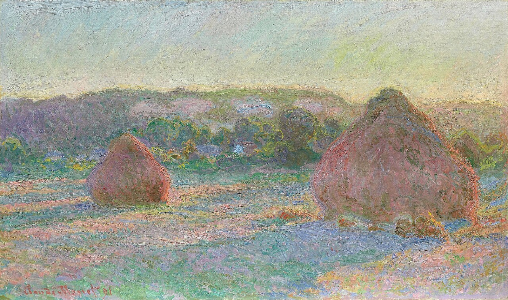](https://commons.wikimedia.org/wiki/File:Claude_Monet_-_Stacks_of_Wheat_(End_of_Summer)_-_1985.1103_-_Art_Institute_of_Chicago.jpg) **Stacks of Wheat (End of Summer)** · 1890-1891 Art Institute of Chicago · Public domain 观察：同一主体的时段、季节与阴影色温对照 |
| [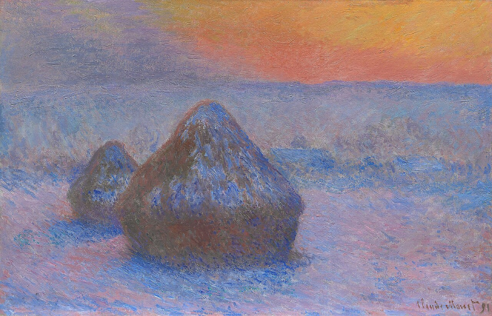](https://commons.wikimedia.org/wiki/File:Claude_Monet_-_Stacks_of_Wheat_(Sunset,_Snow_Effect)_-_1922.431_-_Art_Institute_of_Chicago.jpg) **Stacks of Wheat (Sunset, Snow Effect)** · 1890-1891 Art Institute of Chicago · Public domain 观察：同一主体的时段、季节与阴影色温对照 | [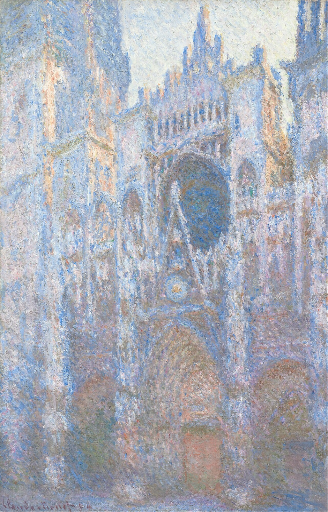](https://commons.wikimedia.org/wiki/File:Claude_Monet_-_Rouen_Cathedral,_West_Fa%C3%A7ade_-_Google_Art_Project.jpg) **Rouen Cathedral, West Façade** · 1894 National Gallery of Art · Public domain 观察：同一建筑在光照变化下的形体与色彩 | [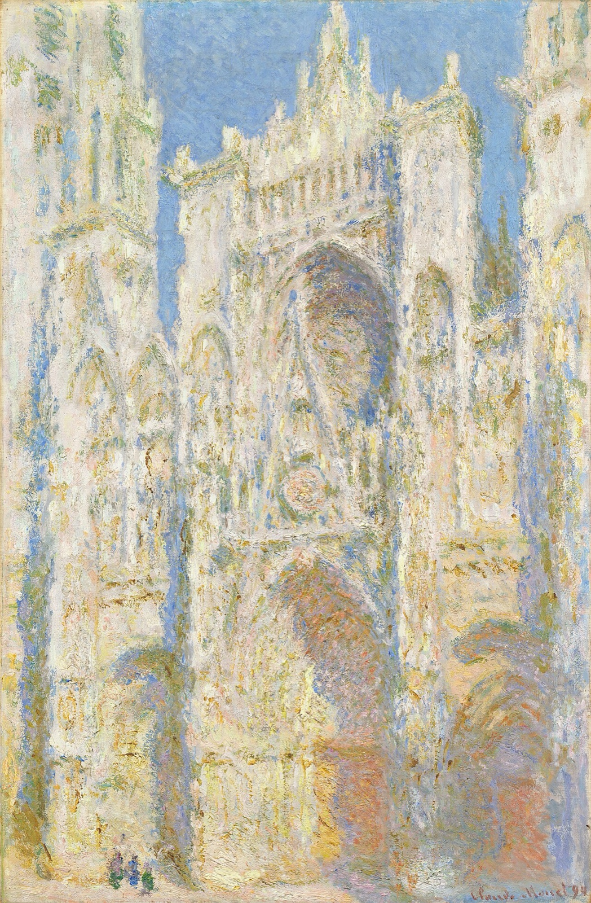](https://commons.wikimedia.org/wiki/File:Claude_Monet,_Rouen_Cathedral,_West_Fa%C3%A7ade,_Sunlight,_1894,_NGA_46654.jpg) **Rouen Cathedral, West Façade, Sunlight** · 1894 National Gallery of Art · Public domain 观察：同一建筑在光照变化下的形体与色彩 |
| [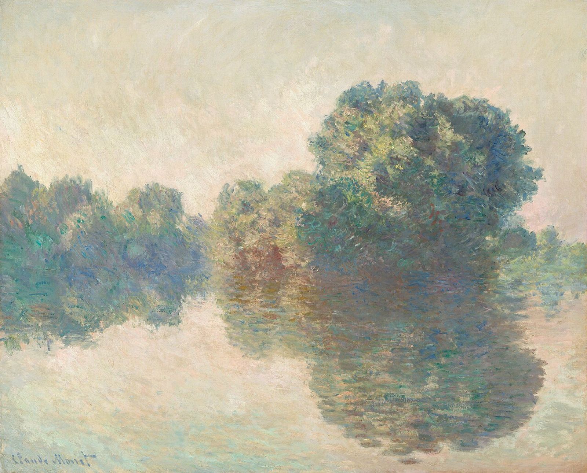](https://commons.wikimedia.org/wiki/File:Claude_Monet,_The_Seine_at_Giverny,_1897,_NGA_46655.jpg) **The Seine at Giverny** · 1897 National Gallery of Art · Public domain 观察：水面笔触方向、岸线与远近色调 | [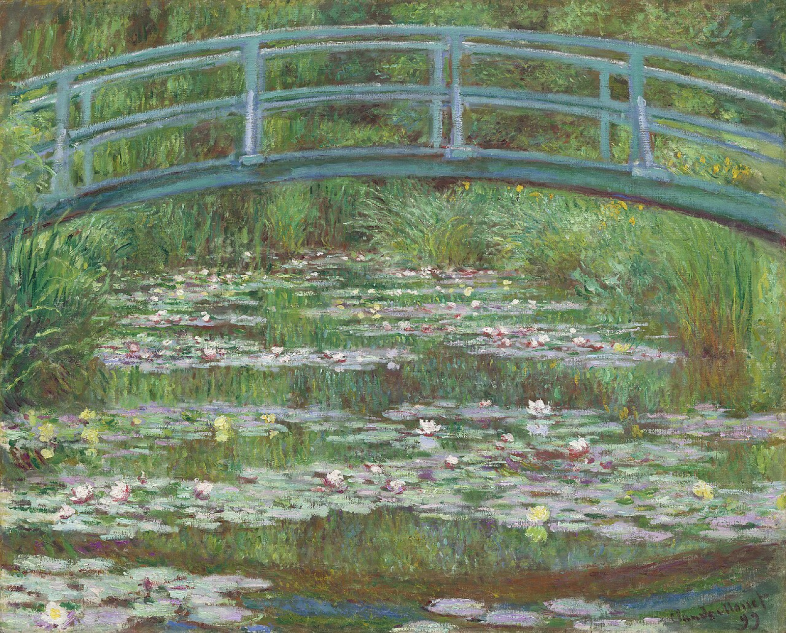](https://commons.wikimedia.org/wiki/File:Claude_Monet,_The_Japanese_Footbridge,_1899,_NGA_74796.jpg) **The Japanese Footbridge** · 1899 National Gallery of Art · CC0 观察：花草短笔触、局部颜色与空间组织 | — |

## 1900–1926：9 件

| 作品 | 作品 | 作品 |
|:---|:---|:---|
| [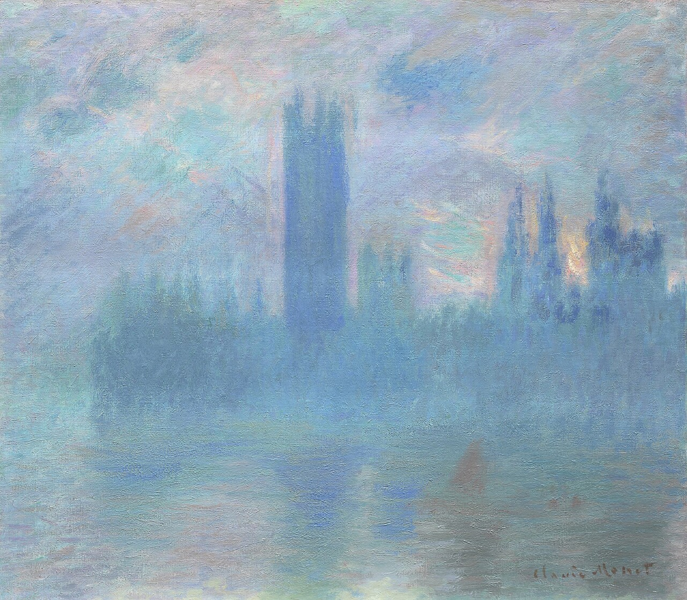](https://commons.wikimedia.org/wiki/File:Claude_Monet,_Houses_of_Parliament,_London,_1900-1903,_1933.1164,_Art_Institute_of_Chicago.jpg) **Houses of Parliament, London** · 1900-1903 Art Institute of Chicago · CC0 观察：城市建筑在复杂光照与空气中的轮廓 | [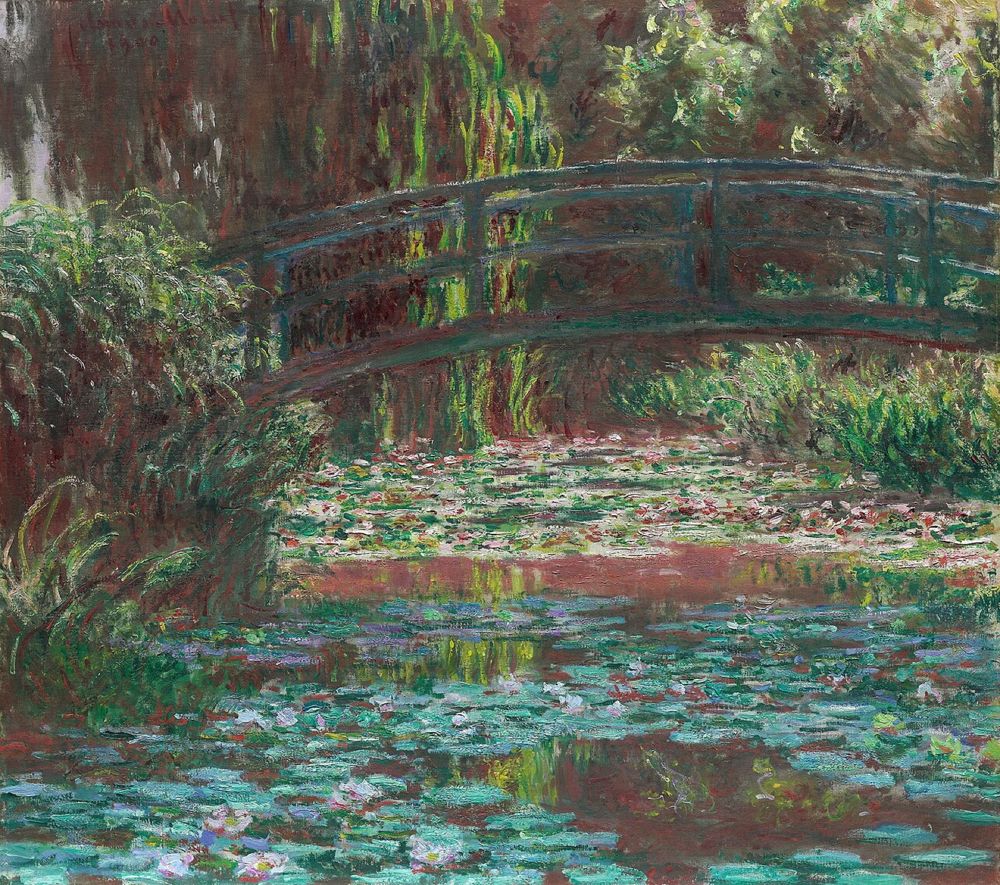](https://commons.wikimedia.org/wiki/File:Claude_Monet_-_Water_Lily_Pond_-_1933.441_-_Art_Institute_of_Chicago.jpg) **Water Lily Pond** · 1900 Art Institute of Chicago · Public domain 观察：水面反射、物体/倒影与画面边界 | [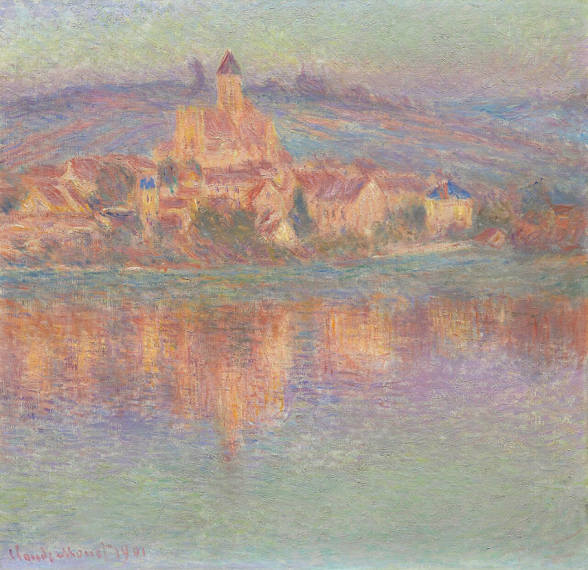](https://commons.wikimedia.org/wiki/File:Claude_Monet_-_V%C3%A9theuil_-_1933.1161_-_Art_Institute_of_Chicago.jpg) **Vétheuil** · 1901 Art Institute of Chicago · Public domain 观察：地形概括、植被轮廓与空间层次 |
| [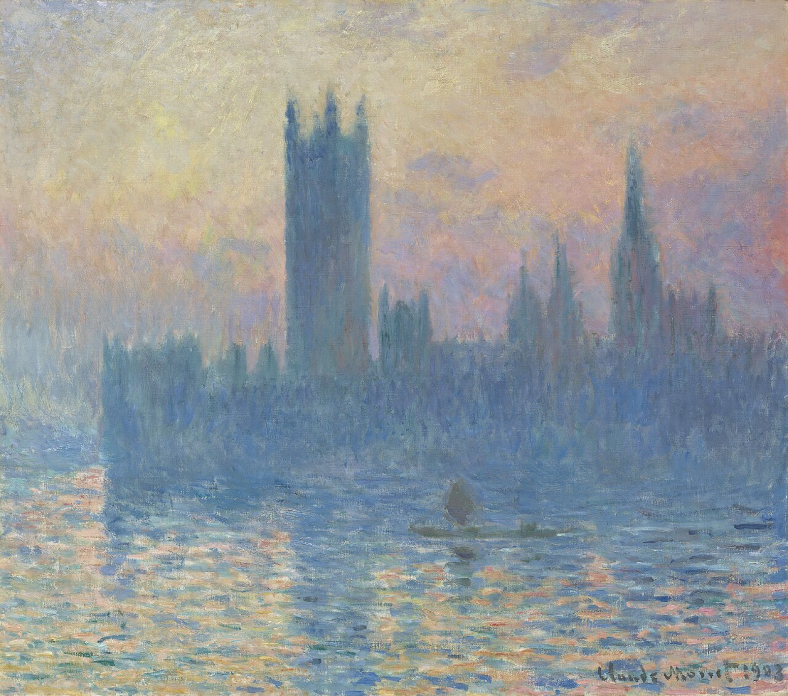](https://commons.wikimedia.org/wiki/File:Claude_Monet,_The_Houses_of_Parliament,_Sunset,_1903,_NGA_46523.jpg) **The Houses of Parliament, Sunset** · 1903 National Gallery of Art · CC0 观察：城市建筑在复杂光照与空气中的轮廓 | [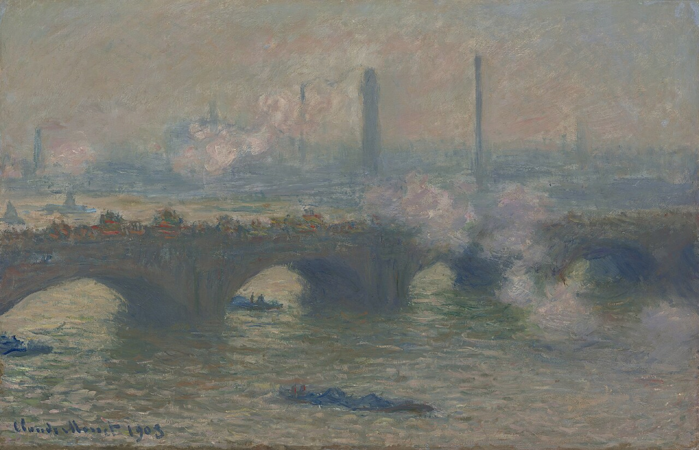](https://commons.wikimedia.org/wiki/File:Claude_Monet,_Waterloo_Bridge,_Gray_Day,_1903,_NGA_46658.jpg) **Waterloo Bridge, Gray Day** · 1903 National Gallery of Art · CC0 观察：雾、桥梁剪影、天空和河面之间的色调 | [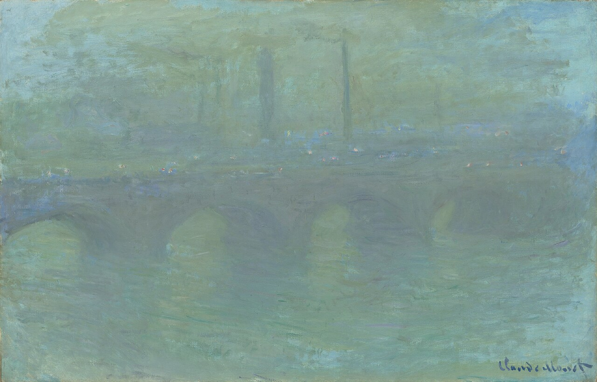](https://commons.wikimedia.org/wiki/File:Claude_Monet,_Waterloo_Bridge,_London,_at_Dusk,_1904,_NGA_61377.jpg) **Waterloo Bridge, London, at Dusk** · 1904 National Gallery of Art · CC0 观察：雾、桥梁剪影、天空和河面之间的色调 |
| [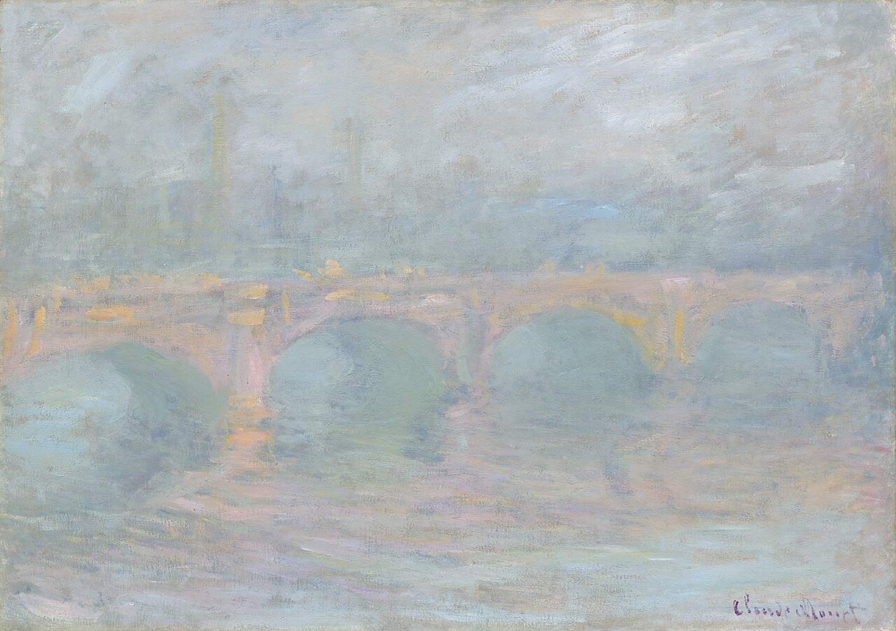](https://commons.wikimedia.org/wiki/File:Claude_Monet,_Waterloo_Bridge,_London,_at_Sunset,_1904,_NGA_61378.jpg) **Waterloo Bridge, London, at Sunset** · 1904 National Gallery of Art · CC0 观察：雾、桥梁剪影、天空和河面之间的色调 | [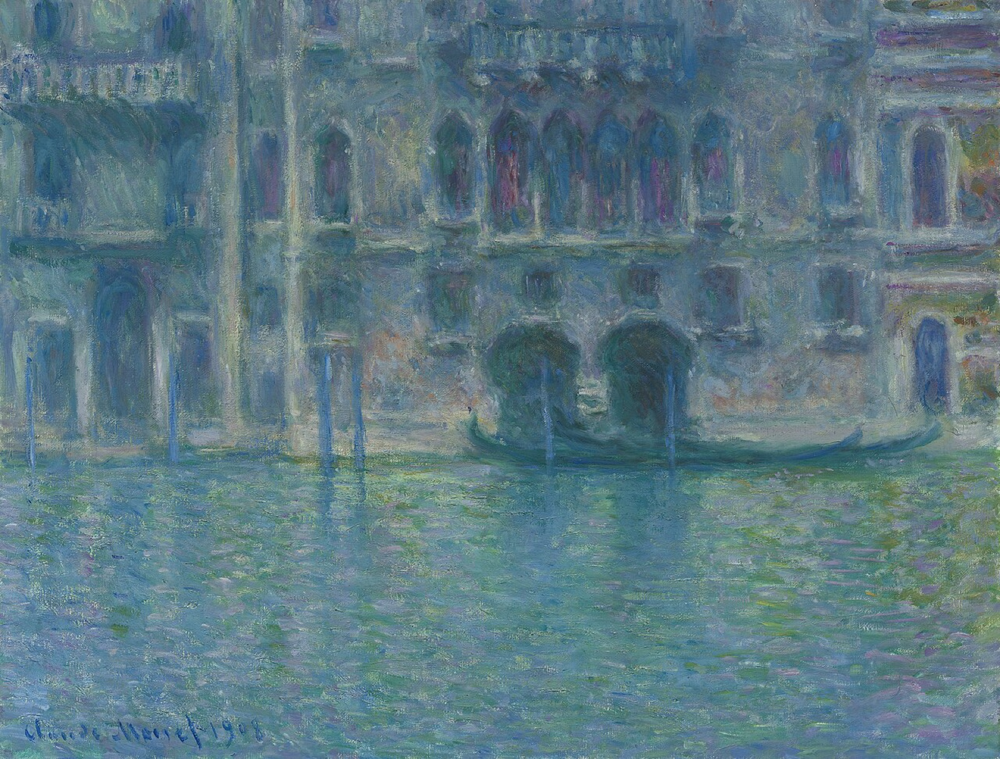](https://commons.wikimedia.org/wiki/File:Claude_Monet,_Palazzo_da_Mula,_Venice,_1908,_NGA_46657.jpg) **Palazzo da Mula, Venice** · 1908 National Gallery of Art · CC0 观察：城市建筑在复杂光照与空气中的轮廓 | [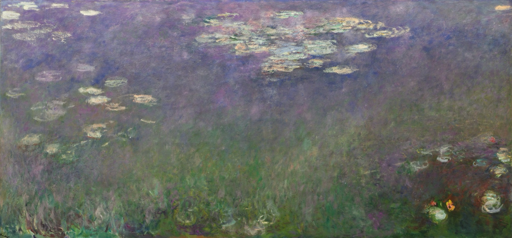](https://clevelandart.org/art/1960.81) **Water Lilies (Agapanthus)** · c. 1915–26 Cleveland Museum of Art · CC0 观察：水面反射、物体/倒影与画面边界 |

## 建议对照的系列

- **Haystacks（干草堆）**：同一对象在不同时间、季节、雪景下的色温和阴影。
- **Rouen Cathedral（鲁昂大教堂）**：建筑结构恒定，但不同光线产生明显的视觉变化。
- **Waterloo Bridge（滑铁卢桥）**：浓雾、日落、暮色条件下的轮廓、色调与水面。
- **园林与水面**：比较 1880 年代花园、1899 年步桥、1900 年水池和晚期睡莲，避免把不同阶段硬混成单一滤镜。

下一阶段可以研究特定画面的局部笔触、材质与颜料层次，再设计生成系统的风格约束和测试。
